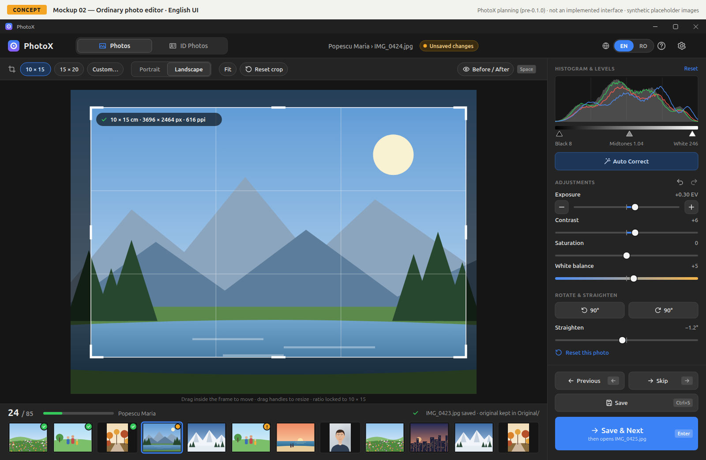
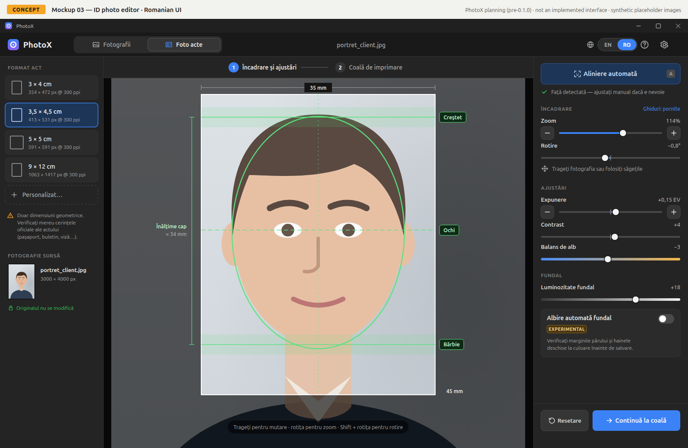

# PhotoX

PhotoX is a lightweight, offline photo-preparation desktop application for a small professional photo studio. It replaces a workflow built on ACDSee, Photoshop and older Mitsubishi kiosk software with one focused tool:

- **Photos:** open an order folder, crop to 10×15 / 15×20 / 13×18 (centred on 15×20), correct exposure, colour and levels, then **Enter = Save & Next**. Originals are kept temporarily in an `Original` subfolder for re-editing until **Finish Order**.
- **ID Photos:** frame a portrait with face guides and optional Auto Align, adjust it, and export a 10×15 sheet with timestamped filenames to a chosen folder.

The UI is in Romanian and English. All processing is local and no customer photo ever leaves the computer.

## Current status

> **Version 0.5.0**: ordinary-photo editing, Finish Order, ID Photo Creator with Auto Align, and a Windows installer, plus the owner's feedback from testing 0.4.0 (prompt_03): the Finish Order fix (0.4.1), a much faster editor, an applied-crop preview, and reworked browsing and ID controls. Verified by automated tests on Linux and in CI on Windows. **Studio use on Windows, physical Citizen prints and the Romanian review are still pending the owner.** See [CHANGELOG](docs/CHANGELOG.md) and [IMPLEMENTATION_LOG](docs/IMPLEMENTATION_LOG.md).

| Item | State |
|---|---|
| Plan | revision P-2 (simplified; all open questions decided) |
| UI mockups | concept screens, EN and RO, in `docs/mockups/` |
| GitHub repository | <https://github.com/NorbCraft/PhotoX> (private); CI on Linux and Windows |

## Documentation

| Start here | |
|---|---|
| [docs/PLAN.md](docs/PLAN.md) | **Source of truth:** scope, requirements (FR/NFR IDs), assumptions, acceptance |
| [docs/ARCHITECTURE.md](docs/ARCHITECTURE.md) | Technology choices, module structure, image pipeline, safe-save design, diagrams |
| [docs/ROADMAP.md](docs/ROADMAP.md) | Milestones 0.1.0 → 1.0.0, dependencies, risks |
| [docs/OPEN_QUESTIONS.md](docs/OPEN_QUESTIONS.md) | Decisions needed from the owner, with recommended defaults |
| [docs/DECISIONS.md](docs/DECISIONS.md) | Decision log |
| [docs/TEST_PLAN.md](docs/TEST_PLAN.md) | Verification strategy and release acceptance |
| [docs/DEVELOPMENT.md](docs/DEVELOPMENT.md) | Git, versioning, coding and AI-agent conventions |
| [docs/mockups/](docs/mockups/README.md) | Concept mockups and navigation structure |
| [docs/IMPLEMENTATION_LOG.md](docs/IMPLEMENTATION_LOG.md), [docs/CHANGELOG.md](docs/CHANGELOG.md) | Progress and release history |
| [docs/prompts/](docs/prompts/README.md) | Archive of the prompts that direct the project |
| [AGENTS.md](AGENTS.md) | Rules for AI coding agents working in this repository |

## Mockup preview (concept)





## Platforms and technology

| | |
|---|---|
| Production platform | **Windows 11 x64** |
| Development platform | Linux Mint (with a Windows 11 VM and physical Windows PCs for testing) |
| Stack | C# · .NET 10 LTS · Avalonia UI 12.1 · CommunityToolkit.Mvvm · Magick.NET 14.17 · ONNX Runtime (Auto Align) |
| CI | GitHub Actions on `ubuntu-latest` and `windows-latest` once the remote exists |
| Printing | via Citizen software (CY-02); future: LinkServer hot folders |

## Build and run

```bash
export PATH="$HOME/.dotnet:$PATH"      # .NET 10 SDK
dotnet test PhotoX.slnx                # run tests
dotnet run --project src/PhotoX.App    # start PhotoX
dotnet publish src/PhotoX.App -c Release -r win-x64 --self-contained -p:DebugType=None -o publish/win-x64   # Windows build
dotnet tool restore && dotnet vpk "[win]" pack --packId PhotoX --packVersion 0.5.0 --packDir publish/win-x64 \
  --mainExe PhotoX.exe --icon assets/logo/photox.ico --packTitle PhotoX --outputDir releases/win          # Windows installer
```

## Repository hosting

The repository is hosted on GitHub at `NorbCraft/PhotoX`. GitHub Actions builds and tests every push on `ubuntu-latest` and `windows-latest` and produces the Windows package ([.github/workflows/ci.yml](.github/workflows/ci.yml)).

## Licence

Private software for a single studio, not distributed (OQ-027). Third-party licences are listed in [THIRD-PARTY-NOTICES.md](THIRD-PARTY-NOTICES.md).
