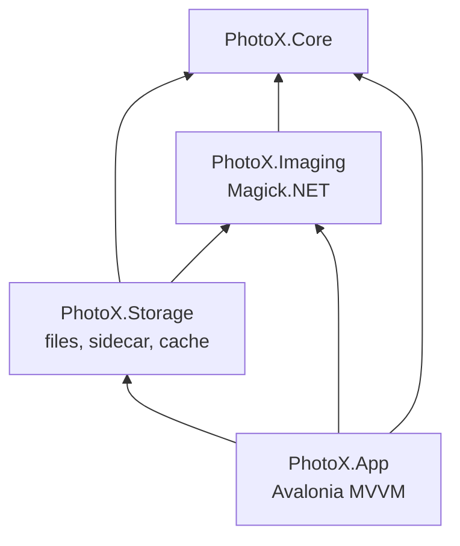
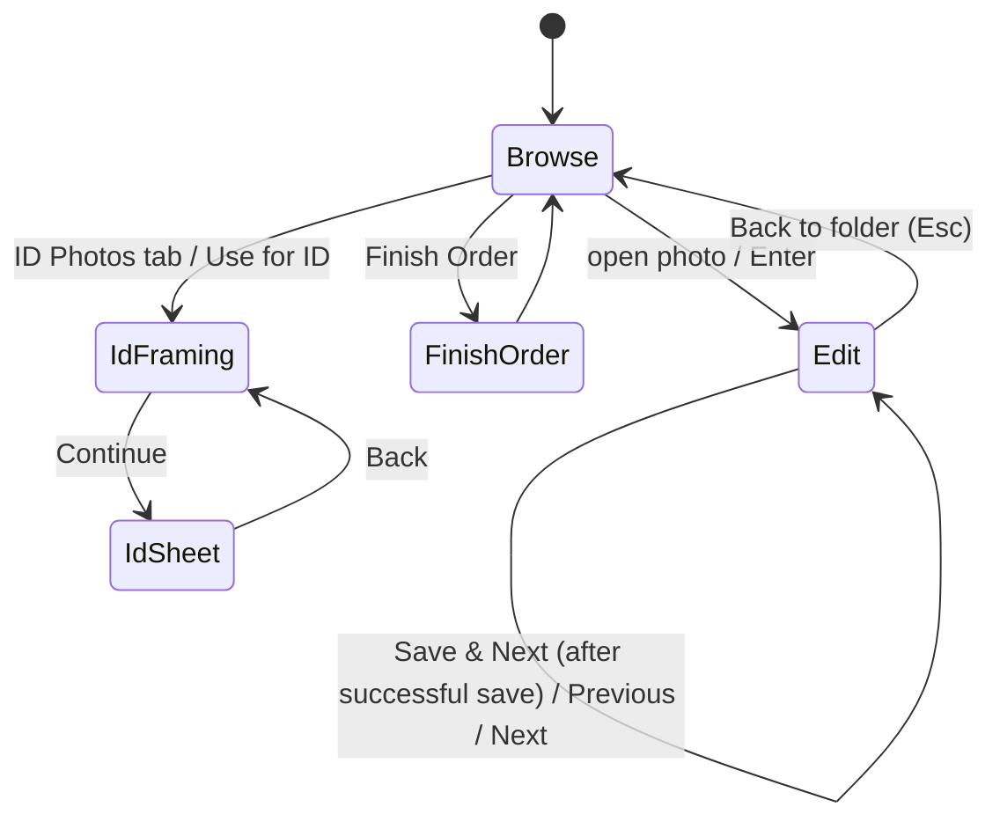

# PhotoX — Architecture

Plan revision **P-2** (2026-10-29). Requirements are in [PLAN.md](PLAN.md) and are referenced by ID. This document describes how PhotoX is built, and is kept deliberately modest: **Magick.NET does the image work, and custom code exists only for geometry, layout, histogram statistics, model integration and one parallel pass that applies Magick-computed tone curves (DEC-044).**

## 1. Principles

1. **Simple and reliable first.** Few projects, few abstractions, and only where there is a concrete use (NFR-009).
2. **Edits are parameters.** An `EditRecipe` (crop, rotation, adjustments, composition) describes every edit. Saving renders it on the full-resolution original. The preview applies the same tone curves to a screen-sized proxy and lets the canvas draw rotation, crop and borders, so the screen shows what will be saved (verified by a test, prompt_03 §4).
3. **Never damage what exists.** Write to a temp file, check it, then replace. Preserve the first original, and never overwrite an uncertain backup (FR-005, FR-021–FR-023).
4. **Offline.** No network access (NFR-001).

## 2. Technology (pinned at implementation, 2026-10-29)

| Area | Choice | Version | Licence | Notes |
|---|---|---|---|---|
| Runtime | .NET 10 (LTS) | SDK 10.0.403 | MIT | supported until 2028-11 |
| UI | Avalonia UI + Fluent theme + Inter font | 12.1.4 | MIT | current stable line. TreeDataGrid and DataGrid not used. |
| MVVM | CommunityToolkit.Mvvm | 8.4.2 | MIT | source generators |
| Imaging | **Magick.NET-Q16-x64** | **14.17.2** | Apache-2.0 + ImageMagick licence | contains win-x64 and linux-x64 natives. 14.17.2 was chosen over 15.0.0 (released 2026-10-10 with breaking API changes) for maturity. Revisit after 1.0. |
| Face detection | Microsoft.ML.OnnxRuntime + YuNet model | 1.31.1 / 2023mar | MIT / MIT | 0.4.0, Auto Align only |
| Logging | Serilog + Serilog.Sinks.File (used directly in the app; libraries return typed results instead of logging) | 4.4.0 / 7.0.0 | Apache-2.0 | DEC-040 |
| Tests | xUnit v3 **3.2.2** + Avalonia.Headless.XUnit | 3.2.2 / 12.1.4 | Apache-2.0 / MIT | xUnit 4.x breaks Avalonia.Headless (Avalonia issue #22072) |
| Installer | Velopack | 1.2.x | MIT | 0.4.0. Self-contained folder build for early trials. |

All licences permit use in a paid studio. Notices are collected in `THIRD-PARTY-NOTICES.md`. Avalonia's paid tools are not needed. Rejected for licence reasons: ImageSharp, FluentAssertions 8+, Emgu CV, InsightFace/dlib-68/BRIA models.

## 3. Projects

```text
PhotoX.slnx
Directory.Build.props        # version, nullable, warnings-as-errors
Directory.Packages.props     # central pinned versions
src/
  PhotoX.Core/       pure: models, crop/rotation geometry, print formats, ID sizes, sheet layout,
                     file-name rules, sidecar model. No I/O except JSON (de)serialisation helpers.
  PhotoX.Imaging/    Magick.NET: load (orient, colour), render recipe, encode, thumbnails,
                     histogram, Auto Correct estimation, ID render, sheet render; face detection (0.4.0)
  PhotoX.Storage/    file handling: folder scan, order state + sidecar, safe save, Finish Order
                     cleanup, thumbnail cache, settings
  PhotoX.App/        Avalonia UI: views, view models, localization, composition
tests/
  PhotoX.Tests/      Core + Imaging + Storage tests (synthetic fixtures generated at test time)
  PhotoX.App.Tests/  Avalonia.Headless UI tests
assets/              print-formats.json, id-sizes.json, logo SVG/ICO, (0.4.0) ONNX model + licence
```



Rules:
- Only `PhotoX.Storage` writes into order folders or the ID output folder.
- View models hold no image math or file I/O.

## 4. UI structure

- **Shell:** native window title bar with the PhotoX icon and name (shown once, prompt_03 §8); top bar (Photos | ID Photos, folder/photo context, EN|RO, settings) and a content area. The three pages (Browse, Edit, ID) are created once and shown or hidden, so switching never rebuilds the gallery.
- **Photos workspace:** *Browse* (explorer with a folder tree, four recent orders, gallery, collapsible details, Start editing / Finish Order) ⇄ *Edit* (one fixed toolbar row, canvas with crop overlay or the applied result, resizable adjustment panel, filmstrip, actions; Save & Next becomes Close when the order is done).
- **ID workspace:** *Framing* → *Sheet*, with the same resizable panel.
- **Shared adjustments:** `ToneAdjustmentsViewModel` + `ToneAdjustmentsView` (levels histogram with three triangle handles, exposure − / +, contrast, white balance, tint, saturation with gradient tracks) are used by both workspaces (prompt_03 §7).
- **Localization:** `Localization/Strings_en.json` / `Strings_ro.json` (embedded), a `Localizer`, and a `{l:Tr Key}` markup extension that binds to one observable `LocalizedString` per key, so language switches live (FR-009, DEC-039). Romanian plurals (1 fotografie / 2–19 fotografii / 20+ de fotografii) via `Localizer.Plural`.
- **Keyboard:** handled at window level with `KeyDown` (tunnelling). Shortcuts are ignored when `e.Handled`, when a `TextBox`/`NumericUpDown`/`ComboBox` has focus, when a dialog is open, or for auto-repeat. Avalonia exposes no repeat flag, so the handler tracks key-down/key-up pairs and ignores repeated `KeyDown` events for a key that is still held (FR-018).



## 5. Image processing (Magick.NET)

### 5.1 Load
1. Detect the real format from the first bytes (JPEG/PNG; HEIC/others give *Unsupported* with a reason).
2. Check dimensions with `MagickImageInfo` (header only) **before** decoding: refuse > 210 MP; check available memory for > 64 MP (FR-037). Set `ResourceLimits` as a guard against decompression bombs.
3. Read with `MagickReadSettings`. Thumbnails and preview use the JPEG `size` hint (DCT downscaling) for speed.
4. `AutoOrient()` (FR-032).
5. Colour: CMYK goes through the embedded profile or the generic CMYK profile to sRGB. An embedded non-sRGB RGB profile is transformed to sRGB. Untagged images are treated as sRGB (FR-034).

### 5.2 Recipe and render order

`EditRecipe` (Core, immutable record):
- `QuarterTurns`, `StraightenDegrees`;
- `Crop` (normalised to the rotated image), `FormatId`, `Orientation`, `Composition` (Fill | WholeWithBorder);
- `Exposure`, `Contrast`, `Saturation`, `Temperature`, `Tint`, `Levels(Black, Mid, White)`.

The renderer applies the steps in a fixed order. The same code serves preview (proxy) and save (full resolution):

| # | Step | Magick.NET operation |
|---|---|---|
| 1 | quarter turns | `Rotate(90·n)`, exact |
| 2 | straighten | `Distort(ScaleRotateTranslate, θ)` with an explicit viewport and white background. The crop is constrained to the valid area by Core geometry. |
| 3 | crop | `Crop(geometry)` + `ResetPage()`. Geometry comes from the normalised crop rounded to pixel edges (exact selected crop, FR-004). |
| 4 | white balance, tint, exposure | in linear light (`ColorSpace = RGB`): per-channel `Evaluate(Multiply)` with combined gains = 2^EV × WB/tint gains; then back to sRGB |
| 5 | levels | `Level(black, white, midGamma)` |
| 6 | contrast | `SigmoidalContrast(increase/decrease, strength, 50%)` |
| 7 | saturation | `Modulate(100, 100+s, 100)` with `modulate:colorspace=HCL` (perceptual) |
| 8 | composition | `Extent(w, h, Gravity.Center, White)` for whole-photo borders and the 13×18-on-15×20 canvas (§5.4) |
| 9 | output colour | ensure sRGB, set the embedded sRGB profile |

Steps 4–6 act on each channel independently, so `ToneCurve` runs them once with Magick.NET on a gradient that contains every 16-bit input value and keeps the result as lookup tables. `ToneProcessor` applies the tables and step 7 (the HCL formula of Magick's modulate) in one parallel pass. Tests show the output equals the Magick operations within one 16-bit level (DEC-044). This was needed because the bundled Magick.NET native library runs single-threaded: the operations took 3.2 s per 12 MP save and 0.3–1 s per preview update. Before/after shows the proxy with identity curves.

### 5.3 Preview

- The proxy is decoded once per photo with the JPEG size hint and shrunk to a long edge of 1800 px by box averaging. The next photo is preloaded (FR-052).
- The proxy after quarter turns is kept as BGRA. A tone change builds preview curves (4,096 evaluated points, about 2 ms) and runs one parallel pass into a reused buffer, latest request wins. The result becomes an Avalonia `WriteableBitmap`.
- **Geometry is drawn, not rendered.** `PhotoCanvas` draws the bitmap rotated by the straightening angle inside the straightened bounding box, so the straighten slider costs only a redraw. The crop is an overlay. In the result view (crop applied by double-click or after Save, whole photo with borders, 13×18 canvas), the canvas fits the output canvas to the viewer, fills it white and draws only the crop.
- **Histogram (FR-043):** luminance bins of the shown pixels inside the crop, computed off the UI thread (a small custom loop, since Magick's colour histogram does not provide channel bins efficiently).
- Display assumes an sRGB monitor (documented limitation).

### 5.4 Geometry (Core)

- **Default crop (FR-003):** largest centred rectangle of the preset ratio, with orientation matching the image (portrait if H > W). An image that already has the ratio gives the full image.
- **Ratio lock and bounds:** resizing from any handle keeps the ratio. The rectangle is clamped inside the valid area. After straightening, the valid area is the inscribed region of the rotated image, and the crop is fitted inside it.
- **Exact crop:** stored normalised. Converted to pixels by rounding edges (x0 = round(x·W), x1 = round((x+w)·W)), so the saved crop is the one the operator selected (±0.5 px).
- **13×18 on 15×20 (FR-073):** crop ratio 130:180. Canvas = `round(w·152.4/130) × round(h·203.2/180)`, with the photo centred (§8.1 of PLAN).
- **Whole photo with border (FR-049):** smallest canvas of the target ratio containing the image; no scaling.
- **Effective ppi** = long-edge px ÷ physical long edge (in). It is written as density metadata (FR-033).

### 5.5 Save encoding
- **JPEG:** quality 95, `jpeg:sampling-factor=1x1` (4:4:4).
- **PNG:** keeps bit depth and alpha.
- **Metadata:** EXIF/IPTC/XMP kept by Magick. Orientation is set to TopLeft, the EXIF thumbnail is removed, pixel dimensions are updated, and density is set to the effective ppi.

### 5.6 Auto Correct (FR-045)

Uses histogram percentiles of the cropped proxy:
- black = 0.1st percentile (capped at 6 %);
- white = 99.8th percentile (floored at 88 %);
- exposure moves the median towards 0.46 (60 % of the gap, at most ±1 EV);
- a mild grey-world temperature/tint correction from low-saturation mid-tones, excluding skin hues, at 50 % strength and capped.

The result is written into the recipe as slider values: one undo step, fully adjustable.

## 6. Saving and the order lifecycle (Storage)

### 6.1 Files in an order folder

```text
Order/
  IMG_001.jpg                 edited (or untouched)
  .IMG_001.jpg.photox-tmp     only while a save is being written (hidden)
  Original/                   hidden from the gallery
    IMG_001.jpg               untouched original (temporary, until Finish Order)
    .photox-order.json        sidecar: version, backups, recipes, reviewed marks
```

### 6.2 Save (FR-004, FR-005, FR-021–FR-024, FR-026)

1. **Checks:** the file still has the size and timestamp it had when opened; the folder is writable; the file is not read-only; free space is sufficient. Each failure gives a specific localized message (FR-023).
2. **No-op recipe:** mark the photo Reviewed in the sidecar and stop (FR-024).
3. **Source:** the preserved original if the sidecar records one, else the current file.
4. Render at full resolution and encode to the temp file `.<name>.photox-tmp` (same folder). Read back its header (`MagickImageInfo`) and check the format and dimensions.
5. **First save only:** copy the current file to `Original/<backup name>`. The name is the same as the file's, unless that name exists and is not recorded as this photo's backup; then a collision-safe `name (2).ext` is used (FR-021). The copy goes to a temp name and is then renamed without overwrite. Original timestamps are kept.
6. Replace the destination with the temp file: `File.Move(temp, dest, overwrite: true)`, which is atomic on NTFS and ext4 for the same folder.
7. Update the sidecar (write temp, then replace).

If any step fails, the temp file is deleted and the existing photo and backup are unchanged. **The UI advances only after step 7 succeeds.** There is no journal or recovery service. Because the original is *copied* before the atomic replace, an interruption at any point leaves either the old or the new photo at its path, plus at most a stray temp file. Stray temp files are ignored by the gallery and deleted on the next save of that photo or at Finish Order.

### 6.3 Finish Order (FR-072)

1. If there are unsaved manual edits, offer **Save them** or **Return to editing**.
2. Show one confirmation with **Erase originals and edit history** (selected by default) or **Keep**.
3. **Erase:**
   - delete each backup recorded in the sidecar (only if it still exists);
   - delete the sidecar;
   - delete PhotoX temp files of the order;
   - delete the order's cached thumbnails;
   - delete `Original/` only if it is empty.

   Unknown files are never touched. Failures are listed and the finished photos stay.
4. **Keep:** nothing is deleted. The order is marked finished in settings (recent list).

### 6.4 Thumbnail cache (FR-053)

The cache lives in `%LOCALAPPDATA%/PhotoX/cache/thumbs` (Linux: `$XDG_CACHE_HOME/PhotoX/thumbs`). The key is a SHA-256 of (full path, size, mtime). It has a 1 GB cap with LRU pruning at startup, 30-day expiry, and *Clear cache*. Finish Order removes entries whose path is in the order folder.

## 7. ID Photo Creator

- **Sizes** in `assets/id-sizes.json` (FR-061). Framing state = scale, rotation and centre of the portrait under a fixed frame.
- **Render:** `Distort(ScaleRotateTranslate)` from the full-resolution portrait into exactly `round(mm·300/25.4)` px, then the tone adjustments of §5.2 and the background-brightness lift (FR-064: brightening of light, low-saturation pixels through a soft mask).
- **Preview:** the framing preview uses the proxy, half or quarter copy whose scale to the screen is closest to 1, with fast bilinear lookups and preview curves; it is about three times faster than resampling the 1800-px proxy.
- **Sheet layout (Core, FR-066/FR-074, DEC-046):** 4×6 in page, landscape for 3×4 and for any size where landscape fits more copies, otherwise portrait. Columns and rows are `⌊(avail + gap)/(cell + gap)⌋`. With the 3×4 strip the cell is 30 × 47 mm and the strip is also the gap to the next row. The grid is centred and copies fill row-major. No cut guides are drawn.
- **Export (FR-068/FR-075):** a 1800×1200 or 1200×1800 px page at 300 ppi, sRGB, JPEG q95 or PNG, written to the remembered folder as `ID_yyyyMMdd_HHmm[_n].ext` using create-new semantics (never overwrite).
- **Auto Align (FR-063, 0.4.0):**
  - YuNet (MIT, ≈ 230 KB) runs on ONNX Runtime on a 640-px copy, giving face boxes and 5 landmarks.
  - With one face: roll comes from the eye line, and head height is estimated from the eye-to-mouth distance and fitted to the guides.
  - With several faces: the boxes are shown and the operator picks one.
  - The result is an ordinary framing state, so it is undoable and adjustable.
- **Background whitening (FR-065):** a bounded experiment in 0.4.0 (for example MODNet, Apache-2.0). It is shipped only if useful.

## 8. Settings, logging and errors

- **Settings:** `settings.json` in `%APPDATA%/PhotoX` (`$XDG_CONFIG_HOME/PhotoX`), written atomically. It stores language, last folder, recent folders, ID output folder, JPEG quality and cache limits.
- **Logs:** Serilog daily files in `%LOCALAPPDATA%/PhotoX/logs`, kept for 14 days. File paths are logged, never image content (FR-051).
- **Errors:** unhandled exceptions are logged and shown as a localized message. Expected failures (save, load) return typed results with a message key.

## 9. Printing boundary (deferred, FR-050)

Print formats are data (`print-formats.json`). A later version could copy finished files into a Citizen LinkServer hot folder chosen in Settings. No printing code exists now.

## 10. Performance notes

- Thumbnails decode with the JPEG size hint, run in parallel (≤ 4 workers), visible items first, and use the disk cache.
- Preview: tone changes cost one parallel pass over the 1800-px proxy; straightening, crop and borders cost only a redraw (DEC-044, DEC-045).
- Full-resolution work happens only while saving, one image at a time. Tone adjustments run in parallel; decoding, straightening (EWA distort) and JPEG encoding are single-threaded in the bundled Magick.NET.
- Pages stay alive between switches; folder scanning and thumbnail decoding run off the UI thread; the gallery is updated in place.
- Q16 memory is about 8 bytes per pixel (24 MP ≈ 200 MB). The memory check before decoding large images uses `GC.GetGCMemoryInfo().TotalAvailableMemoryBytes`.
- Numbers are measured and recorded in [IMPLEMENTATION_LOG.md](IMPLEMENTATION_LOG.md), not assumed (NFR-003).
