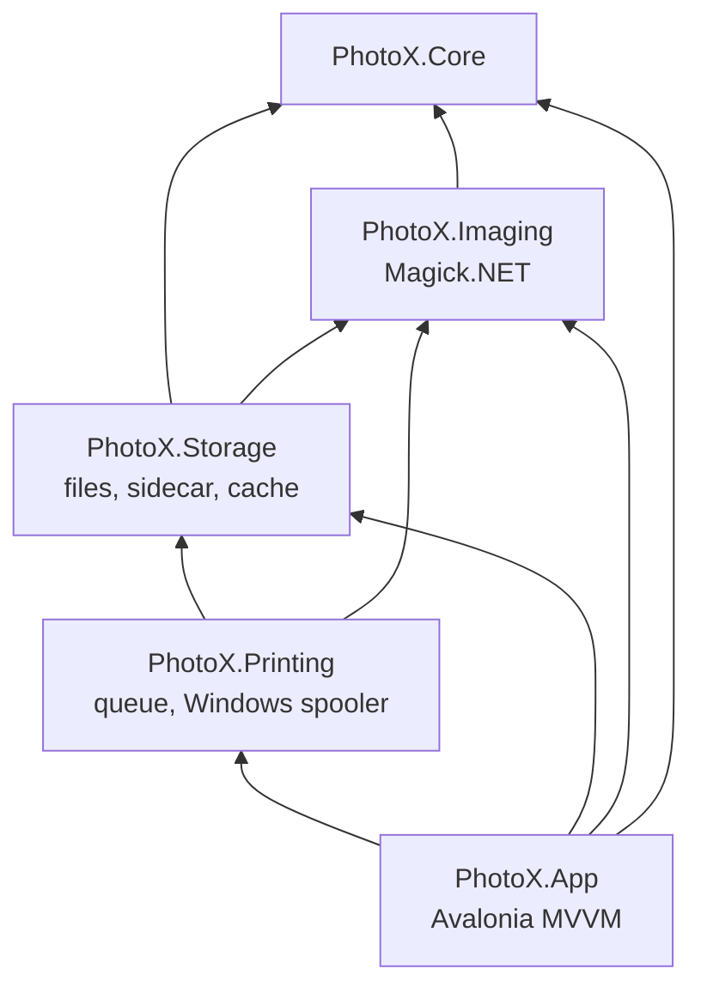
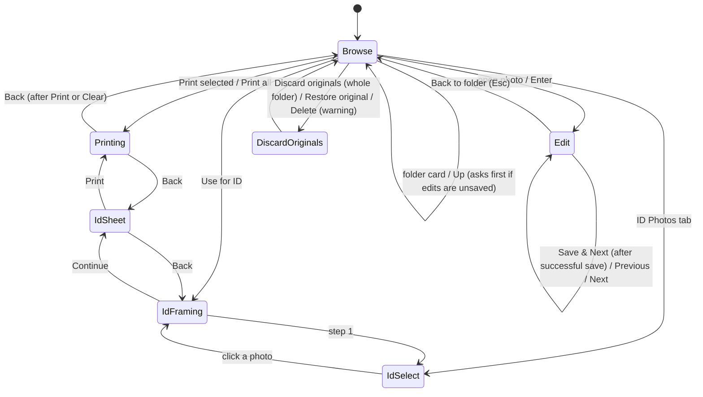
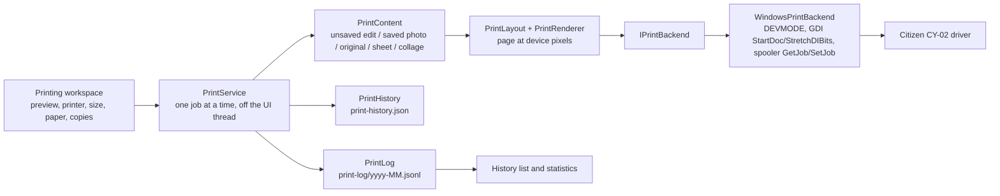

# PhotoX — Architecture

Plan revision **P-2** (2026-10-29). Requirements are in [PLAN.md](PLAN.md) and are referenced by ID. This document describes how PhotoX is built, and is kept deliberately modest: **Magick.NET does the image work, and custom code exists only for geometry, layout, histogram statistics, model integration and one parallel pass that applies Magick-computed tone curves (DEC-044).**

## 1. Principles

1. **Simple and reliable first.** Few projects, few abstractions, and only where there is a concrete use (NFR-009).
2. **Edits are parameters.** An `EditRecipe` (crop, rotation, adjustments, composition) describes every edit. Saving renders it on the full-resolution original. The preview applies the same tone curves to a screen-sized proxy and lets the canvas draw rotation, crop and borders, so the screen shows what will be saved (verified by a test, prompt_03 §4).
3. **Never damage what exists.** Write to a temp file, check it, then replace. Preserve the first original, and never overwrite an uncertain backup (FR-005, FR-021–FR-023).
4. **Offline.** No network access (NFR-001).

## 2. Technology (pinned at implementation, 2026-10-29)

| Area | Choice | Version | Licence | Notes |
|---|---|---|---|---|
| Runtime | .NET 10 (LTS) | SDK 10.0.403 | MIT | supported until 2028-11 |
| UI | Avalonia UI + Fluent theme + Inter font | 12.1.4 | MIT | current stable line. TreeDataGrid and DataGrid not used. |
| MVVM | CommunityToolkit.Mvvm | 8.4.2 | MIT | source generators |
| Imaging | **Magick.NET-Q16-x64** | **14.17.2** | Apache-2.0 + ImageMagick licence | contains win-x64 and linux-x64 natives. 14.17.2 was chosen over 15.0.0 (released 2026-10-10 with breaking API changes) for maturity. Revisit after 1.0. |
| Face detection | Microsoft.ML.OnnxRuntime + YuNet model | 1.31.1 / 2023mar | MIT / MIT | 0.4.0, Auto Align only |
| Logging | Serilog + Serilog.Sinks.File (used directly in the app; libraries return typed results instead of logging) | 4.4.0 / 7.0.0 | Apache-2.0 | DEC-040 |
| Tests | xUnit v3 **3.2.2** + Avalonia.Headless.XUnit | 3.2.2 / 12.1.4 | Apache-2.0 / MIT | xUnit 4.x breaks Avalonia.Headless (Avalonia issue #22072) |
| Installer | Velopack | 1.2.x | MIT | 0.4.0. Setup exe and portable zip, named `PhotoX-<version>-win-*` by CI (prompt_04), with the PhotoX icon. Linux: `packaging/linux` adds a desktop entry for a published build. |

All licences permit use in a paid studio. Notices are collected in `THIRD-PARTY-NOTICES.md`. Avalonia's paid tools are not needed. Rejected for licence reasons: ImageSharp, FluentAssertions 8+, Emgu CV, InsightFace/dlib-68/BRIA models.

## 3. Projects

```text
PhotoX.slnx
Directory.Build.props        # version, nullable, warnings-as-errors
Directory.Packages.props     # central pinned versions
src/
  PhotoX.Core/       pure: models, crop/rotation geometry, print formats, ID sizes, sheet layout,
                     collage templates and layout, file-name rules, sidecar model. No I/O.
  PhotoX.Imaging/    Magick.NET: load (orient, colour), render recipe, encode, thumbnails,
                     histogram, Auto Correct estimation, ID render, sheet render, collage render;
                     face detection (0.4.0)
  PhotoX.Storage/    file handling: folder scan, order state + sidecar, safe save, Discard Originals and
                     Restore Original (OrderBackups), Delete and restore (PhotoTrash), Duplicate
                     image, thumbnail cache, settings, data files, print counters, the update
                     client (Updates/UpdateClient: GitHub Releases, verified installer download)
  PhotoX.Printing/   print items, page preparation, the print queue (PrintService) and the
                     Windows driver backend (spooler + GDI); no printing on other platforms
  PhotoX.App/        Avalonia UI: views, view models, localization, composition
tests/
  PhotoX.Tests/      Core + Imaging + Storage tests (synthetic fixtures generated at test time)
  PhotoX.App.Tests/  Avalonia.Headless UI tests
assets/              logo: SVG masters, PNG exports, ICO, build_icons.py; ONNX model + licence
packaging/linux/     desktop entry template and install script (icon in the hicolor theme)
```



Rules:
- Only `PhotoX.Storage` writes into order folders or the ID output folder.
- View models hold no image math or file I/O.

## 4. UI structure

- **Shell:** native window title bar with the PhotoX icon, name and version ("PhotoX 0.9.0", prompt_04 §1); top bar (the folder tree button, prompt_08 §4; Photos | ID Photos | Collages | Printing, each with an icon and the selected one in blue, the Printing tab with the number of jobs in progress; folder/photo context; EN|RO; settings; then the PhotoX logo and name, prompt_05 §1, prompt_06 §1) and a content area. The five pages (Browse, Edit, ID, Collages, Printing) are created once and shown or hidden, so switching never rebuilds the gallery.
- **Light and dark mode (prompt_06 §3, DEC-061):** `App.axaml` defines every colour twice in `ThemeDictionaries` (Dark keeps the earlier palette; Light is a neutral light palette with a mid-grey behind photos) under the same keys, and the views use `DynamicResource`, so `App.ApplyTheme` (Settings, remembered as `theme` in `settings.json`) switches the whole window at once, including the Fluent controls. Status colours are classes (`ok`, `warn`, `error`, `faint`) rather than converters, and the levels histogram picks its colours from the theme variant. The primary blue `#3B82F6` is the same in both modes and is the blue of the icon.
- **Side panels:** every workspace has a resizable explorer on the left and a resizable settings panel on the right (`GridSplitter`, minimum widths, widths remembered in `settings.json`), with the centre taking the rest.
- **Explorer (DEC-055, DEC-077):** `ExplorerViewModel` + `ExplorerView` (locations, four recent orders, folder tree) is one control used by Browse, by the ID portrait picker and by Collages, one instance per workspace (key `photos`, `id`, `collage`). It also owns the open folder, `Navigate` (open a folder and select it in the tree), Up (`GoUp`), `Mark` (select without opening) and `IsTreeVisible`. Every gallery lists the open folder's subfolders as `FolderItemViewModel` cards (one `FolderCard` view) before its photos, under one `LocationBar` (Up and the path). `PhotoPickerViewModel` adds the thumbnail grid (`PickerGrid`, folders and photos in `Items`) of the open folder; thumbnails come from the same cache and loader as the gallery (`ThumbnailSource`). Each workspace keeps its own folder and tree visibility (`WorkspaceFolders`, `TreeHidden` in the settings); pickers start in the order open in Photos the first time. The top-bar button toggles the tree of the shown workspace (`ShellViewModel.CurrentExplorer`); `PanelWidth.Show`/`FollowTree` collapse a hidden panel's column and restore its remembered width.
- **Photos workspace:** *Browse* (explorer, gallery of `GalleryItems` = folder cards then `VisiblePhotos`, with multiple selection and a thumbnail-size slider, filters All, To do, Done and Deleted, state badges top right and print counters bottom right, a right-click menu: Edit, Use for ID photo, Print, Duplicate image, Restore original, Delete, or Restore for a deleted photo; Enter opens the selected folder or edits the photo, Delete asks to delete, Backspace goes up; a details panel with Edit progress and the folder's printed copies, and the actions: Print selected, Print all, Edit this photo, Use for ID photo, Discard originals (the whole folder), Restore original, or under Deleted only Restore selected) ⇄ *Edit* (one fixed toolbar row, canvas with crop overlay or the applied result, resizable adjustment panel with one Reset, filmstrip, actions; Save & Next becomes Close when the order is done; Before/After shows the original while held).
- **ID workspace (prompt_06 §5, prompt_07 §2, prompt_08 §2):** across the photo and the sidebar, a row with the format list, the steps *1 Select photo* / *2 Framing & adjustment* / *3 Print* and Clear; the folder tree on the left. Step 1 (`IsSelectStep`) shows the picker grid of the open folder in the centre and hides the sidebar; a click picks a photo, which loads it and opens step 2 (the loaded photo picked again just returns to step 2). Steps 2 and 3: a toolbar like the editor's (90° turns, Auto Align, zoom, rotation, reset framing, before/after), the photo, and the editing sidebar of Photos with Continue; on the sheet step the sheet options with Back, Save and Print.
- **Collages workspace (prompt_08 §3):** folder tree | thumbnail panel (the picker grid; thumbnails are dragged into frames; resizable) | the collage canvas with slot sizes and a right-click menu | settings (sheet, orientation, templates, spacing, the selected slot's size, Save and Print). The thumbnail and settings panels fold to a 42 px strip with a chevron and their name (`ThumbsCollapsed`, `SettingsCollapsed`, remembered); see §7.1.
- **Printing workspace (prompt_06 §7, prompt_07 §3):** statistics (folded away when Print opens the workspace), the queue of this session and the history (left); the pages as they will print (centre); printer, size, Crop | Whole for photos, paper, copies, Clear and Print (right). Its tab sits at the right of the top bar. Escape and Back return to the workspace it was opened from. See §9.
- **Shared editing sidebar (DEC-062):** `EditActionsView` (Undo, Redo, Reset) and `ToneAdjustmentsView` (levels histogram with three triangle handles, Auto Adjust, exposure, contrast, white balance, tint, saturation with gradient tracks; exposure also on the + / − keys), both bound to one `ToneAdjustmentsViewModel` that carries the owner's Undo, Redo, Reset and Auto Adjust commands. The Photos editor and the ID Photo Creator use them identically (prompt_03 §7, prompt_04 §§7–8, prompt_06 §1).
- **Localization:** `Localization/Strings_en.json` / `Strings_ro.json` (embedded), a `Localizer`, and a `{l:Tr Key}` markup extension that binds to one observable `LocalizedString` per key, so language switches live (FR-009, DEC-039). Romanian plurals (1 fotografie / 2–19 fotografii / 20+ de fotografii) via `Localizer.Plural`.
- **Keyboard:** handled at window level with `KeyDown` (tunnelling). Shortcuts are ignored when `e.Handled`, when a `TextBox`/`NumericUpDown`/`ComboBox` has focus, when a dialog is open, or for auto-repeat. Avalonia exposes no repeat flag, so the handler tracks key-down/key-up pairs and ignores repeated `KeyDown` events for a key that is still held (FR-018).



## 5. Image processing (Magick.NET)

### 5.1 Load
1. Detect the real format from the first bytes (JPEG/PNG; HEIC/others give *Unsupported* with a reason).
2. Check dimensions with `MagickImageInfo` (header only) **before** decoding: refuse > 210 MP; check available memory for > 64 MP (FR-037). Set `ResourceLimits` as a guard against decompression bombs.
3. Read with `MagickReadSettings`. Thumbnails and preview use the JPEG `size` hint (DCT downscaling) for speed.
4. `AutoOrient()` (FR-032).
5. Colour: CMYK goes through the embedded profile or the generic CMYK profile to sRGB. An embedded non-sRGB RGB profile is transformed to sRGB. Untagged images are treated as sRGB (FR-034).

### 5.2 Recipe and render order

`EditRecipe` (Core, immutable record):
- `QuarterTurns`, `StraightenDegrees`;
- `Crop` (normalised to the rotated image), `FormatId`, `Orientation`, `Composition` (Fill | WholeWithBorder);
- `Exposure`, `Contrast`, `Saturation`, `Temperature`, `Tint`, `Levels(Black, Mid, White)`.

The renderer applies the steps in a fixed order. The same code serves preview (proxy) and save (full resolution):

| # | Step | Magick.NET operation |
|---|---|---|
| 1 | quarter turns | `Rotate(90·n)`, exact |
| 2 | straighten | `Distort(ScaleRotateTranslate, θ)` with an explicit viewport and white background. The crop is constrained to the valid area by Core geometry. |
| 3 | crop | `Crop(geometry)` + `ResetPage()`. Geometry comes from the normalised crop rounded to pixel edges (exact selected crop, FR-004). |
| 4 | white balance, tint, exposure | in linear light (`ColorSpace = RGB`): per-channel `Evaluate(Multiply)` with combined gains = 2^EV × WB/tint gains; then back to sRGB |
| 5 | levels | `Level(black, white, midGamma)` |
| 6 | contrast | `SigmoidalContrast(increase/decrease, strength, 50%)` |
| 7 | saturation | `Modulate(100, 100+s, 100)` with `modulate:colorspace=HCL` (perceptual) |
| 8 | composition | `Extent(w, h, Gravity.Center, White)` for whole-photo borders and the 13×18-on-15×20 and 9×13-on-10×15 canvases (§5.4) |
| 9 | output colour | ensure sRGB, set the embedded sRGB profile |

Steps 4–6 act on each channel independently, so `ToneCurve` runs them once with Magick.NET on a gradient that contains every 16-bit input value and keeps the result as lookup tables. `ToneProcessor` applies the tables and step 7 (the HCL formula of Magick's modulate) in one parallel pass. Tests show the output equals the Magick operations within one 16-bit level (DEC-044). This was needed because the bundled Magick.NET native library runs single-threaded: the operations took 3.2 s per 12 MP save and 0.3–1 s per preview update. Before/after shows the proxy with identity curves.

**Saving computes only the kept pixels (prompt_07, DEC-068).** `RecipeRenderer.RenderGeometry` gives exactly the pixels of steps 1–3 without processing the whole photo:
- without straightening, the crop is mapped back through the quarter turns, taken from the photo first, and only that part is turned (both exact copies);
- with straightening, the distortion renders straight into the crop through its viewport, in parallel bands where the Magick library has no OpenMP (Linux).

**Pixel ownership (prompt_07, DEC-067).** `ToneProcessor` writes the image in strips with queued (write-only) pixel access. A clone shares its pixels with the original until the first write, and for a queued write ImageMagick gives a shared image new pixels *without copying them*. The tone pass therefore first makes the image own its pixels (`OwnPixels`, a no-op composite of one transparent pixel), otherwise every strip after the first is read as zeros. This was the cause of photos saved black below their first strip.

### 5.3 Preview

- The proxy is decoded once per photo with the JPEG size hint and shrunk to a long edge of 1800 px by box averaging. The next photo is preloaded (FR-052).
- The proxy after quarter turns is kept as BGRA. A tone change builds preview curves (4,096 evaluated points, about 2 ms) and runs one parallel pass into a reused buffer, latest request wins. The result becomes an Avalonia `WriteableBitmap`.
- **Geometry is drawn, not rendered.** `PhotoCanvas` draws the bitmap rotated by the straightening angle inside the straightened bounding box, so the straighten slider costs only a redraw. The crop is an overlay. In the result view (crop applied by double-click or after Save, whole photo with borders, 13×18 canvas), the canvas fits the output canvas to the viewer, fills it white and draws only the crop.
- **Histogram (FR-043, DEC-054):** luminance bins inside the crop of the tones that enter the levels step: the unadjusted preview pixels mapped through 8-bit tables of the exposure, white-balance and tint curve. Computed off the UI thread (a small custom loop, since Magick's colour histogram does not provide channel bins efficiently) and drawn on a linear scale. Because levels, contrast and saturation are not in it, the levels handles sit on the data they act on.
- Display assumes an sRGB monitor (documented limitation).

### 5.4 Geometry (Core)

- **Default crop (FR-003):** largest centred rectangle of the preset ratio, with orientation matching the image (portrait if H > W). An image that already has the ratio gives the full image.
- **Ratio lock and bounds:** resizing from any handle keeps the ratio. The rectangle is clamped inside the valid area. After straightening, the valid area is the inscribed region of the rotated image, and the crop is fitted inside it.
- **Exact crop:** stored normalised. Converted to pixels by rounding edges (x0 = round(x·W), x1 = round((x+w)·W)), so the saved crop is the one the operator selected (±0.5 px).
- **13×18 on 15×20 (FR-073):** crop ratio 130:180. Canvas = `round(w·152.4/130) × round(h·203.2/180)`, with the photo centred (§8.1 of PLAN).
- **Custom size on a sheet (FR-010, DEC-051):** `PrintFormats.Custom(w, h)` returns a format with the smallest sheet (10×15, 15×20, 20×30) that holds w×h mm as its canvas; `RenderPlan` then applies the 13×18 rule. The recipe stores `CustomWidthMm`/`CustomHeightMm`; older ratio-only custom recipes have no canvas.
- **Whole photo with border (FR-049):** smallest canvas of the target ratio containing the image; no scaling.
- **Effective ppi** = long-edge px ÷ physical long edge (in). It is written as density metadata (FR-033).

### 5.5 Save encoding
- **JPEG:** quality 95, `jpeg:sampling-factor=1x1` (4:4:4).
- **PNG:** keeps bit depth and alpha.
- **Metadata:** EXIF/IPTC/XMP kept by Magick. Orientation is set to TopLeft, the EXIF thumbnail is removed, pixel dimensions are updated, and density is set to the effective ppi.

### 5.6 Auto Correct (FR-045)

Uses histogram percentiles of the cropped proxy:
- black = 0.1st percentile (capped at 6 %);
- white = 99.8th percentile (floored at 88 %);
- exposure moves the median towards 0.46 (60 % of the gap, at most ±1 EV);
- a mild grey-world temperature/tint correction from low-saturation mid-tones, excluding skin hues, at 50 % strength and capped.

The result is written into the recipe as slider values: one undo step, fully adjustable.

## 6. Saving and the order lifecycle (Storage)

### 6.1 Files in an order folder

```text
Order/
  IMG_001.jpg                 edited (or untouched)
  .IMG_001.jpg.photox-tmp     only while a save is being written (hidden)
  Original/                   hidden from the gallery and the explorer
    IMG_001.jpg               untouched original (temporary, until Discard Originals)
    IMG_007 (deleted).jpg     a photo deleted from the gallery, restorable (prompt_08)
    .photox-order.json        sidecar: version (2), backups, recipes, reviewed marks, deleted photos
```

### 6.2 Save (FR-004, FR-005, FR-021–FR-024, FR-026)

1. **Checks:** the file still has the size and timestamp it had when opened; the folder is writable; the file is not read-only; free space is sufficient. Each failure gives a specific localized message (FR-023).
2. **No-op recipe:** mark the photo Reviewed in the sidecar and stop (FR-024).
3. **Source:** the preserved original if the sidecar records one, else the current file.
4. Render at full resolution and encode to the temp file `.<name>.photox-tmp` (same folder). Read back its header (`MagickImageInfo`) and check the format and dimensions.
5. **First save only:** copy the current file to `Original/<backup name>`. The name is the same as the file's, unless that name exists and is not recorded as this photo's backup; then a collision-safe `name (2).ext` is used (FR-021). The copy goes to a temp name and is then renamed without overwrite. Original timestamps are kept.
6. Replace the destination with the temp file: `File.Move(temp, dest, overwrite: true)`, which is atomic on NTFS and ext4 for the same folder.
7. Update the sidecar (write temp, then replace).

If any step fails, the temp file is deleted and the existing photo and backup are unchanged. **The UI advances only after step 7 succeeds.** There is no journal or recovery service. Because the original is *copied* before the atomic replace, an interruption at any point leaves either the old or the new photo at its path, plus at most a stray temp file. Stray temp files are ignored by the gallery and deleted on the next save of that photo or at Finish Order.

### 6.3 Discard Originals and Restore Original (FR-072, FR-083, DEC-056, DEC-079)

Both work one recorded file at a time, only through the sidecar, in `OrderBackups` (Storage). Finish Order and its folder-wide cleanup are gone.

- **Discard Originals** (for the whole folder since prompt_08): the App saves the folder's pending edits with `PhotoSaver` (stopping at the first failure), then `DiscardFolder(folder)`, which runs `RemoveBackups` for every photo the sidecar records and then removes every deleted photo (§6.5) with its kept original, both verified by recorded size and write time before either goes. For each photo, the backup is deleted only if:
  - the sidecar names it with plain file names inside `Original/`;
  - the edited photo exists, is non-empty, reads as an image, and still has the size and write time recorded when PhotoX saved it;
  - the backup still has its recorded size and write time.

  Then the photo's record goes. Otherwise the backup is kept and recorded, and the reason is reported (photo not verified, photo changed, not PhotoX's backup, delete failed). The sidecar is deleted when empty, `Original/` only when empty (never recursively).
- **Restore Original:**
  - the backup (identity checked as above, and readable) is copied to the photo's temp name, compared by SHA-256, and moved over the photo atomically;
  - the photo is compared again;
  - only then are the backup and the record removed.

  Read-only photos and backups that are not PhotoX's are refused and left untouched.

### 6.5 Delete and restore photos (FR-085, DEC-078)

`PhotoTrash` (Storage) never deletes a file:

- **Delete:** for each photo, a free stored name `name (deleted).ext` (`(deleted 2)`, …) is chosen against the files in `Original/` and every name a record uses; all deletions are recorded in the sidecar's `deleted` section (stored name → original name, time, size, write time, the photo's edit record) and saved; then each photo is renamed into `Original/` without overwrite. A failed move removes its record. The photo's own record leaves `photos`; its kept original stays where it is.
- **List:** the recorded deleted photos whose stored file still has the recorded size and write time.
- **Restore:** a verified stored file is moved back to the order folder under its name, or the first free `name (2).ext` (a file or a record using the name counts as taken), without overwrite; then its record returns under that name. `Original/` goes when empty.
- The sidecar stays while deleted photos are recorded; `ChooseBackupName` avoids names that records use.

### 6.4 Thumbnail cache (FR-053)

The cache lives in `%LOCALAPPDATA%/PhotoX/cache/thumbs` (Linux: `$XDG_CACHE_HOME/PhotoX/thumbs`). The key is a SHA-256 of (full path, size, mtime). It has a 1 GB cap with LRU pruning at startup, 30-day expiry, and *Clear cache*. Finish Order removes entries whose path is in the order folder.

## 7. ID Photo Creator

- **Sizes** are data (FR-061): `id-sizes.json` in the settings folder, created with the planned sizes on first start; implausible entries are ignored (DEC-049); entries still equal to a 0.6.0 default are replaced by the current default (DEC-052). A size can turn off its guides (`Guides`, 9×12) and bring its own sheet margin and spacing (2×2 in: 0 mm). Custom sizes (+ New size) are stored in `settings.json` and created with `IdSizes.Custom`. Framing state = scale, fine rotation, quarter turns and centre of the portrait under a fixed frame of the size's ratio. A 90° turn (prompt_06 §5) is part of the framing (`IdFraming.QuarterTurns`; the frame angle is the fine rotation less 90° per turn), so preview, sheet, save and print follow without turning the portrait; Auto Align runs on a turned copy of the proxy and maps the face back. The 2 × 2 in size is labelled 5 × 5 cm and stays 50.8 mm.
- **Render:** `Distort(ScaleRotateTranslate)` from the full-resolution portrait into exactly `round(mm·300/25.4)` px, then the tone adjustments of §5.2 and the background-brightness lift (FR-064: brightening of light, low-saturation pixels through a soft mask).
- **Preview:** the framing preview uses the proxy, half or quarter copy whose scale to the screen is closest to 1, with fast bilinear lookups and preview curves; it is about three times faster than resampling the 1800-px proxy. It is rendered in two steps (`FramePreview`, then `AdjustPreview`), so the unadjusted frame feeds the levels histogram and **Auto Adjust** (the Auto Correct estimation of §5.6, prompt_04 §8).
- **Sheet layout (Core, FR-066/FR-074, DEC-046):** 4×6 in page, landscape for 3×4 and for any size where landscape fits more copies, otherwise portrait. Columns and rows are `⌊(avail + gap)/(cell + gap)⌋`. With the 3×4 strip the cell is 30 × 47 mm and the strip is also the gap to the next row. The grid is centred and copies fill row-major. No cut guides are drawn.
- **Export (FR-068/FR-075):** a 1800×1200 or 1200×1800 px page at 300 ppi, sRGB, JPEG at the Settings quality (100 by default since 0.9.0; JPEG only since 0.7.0), with the optional print scale correction of FR-071 applied to photo size and positions, written to the remembered folder as `ID_yyyyMMdd_HHmm[_n].ext` using create-new semantics (never overwrite).
- **Auto Align (FR-063, 0.4.0):**
  - YuNet (MIT, ≈ 230 KB) runs on ONNX Runtime on a 640-px copy, giving face boxes and 5 landmarks.
  - With one face: roll comes from the eye line, and head height is estimated from the eye-to-mouth distance and fitted to the guides.
  - With several faces: the boxes are shown and the operator picks one.
  - The result is an ordinary framing state, so it is undoable and adjustable.
- **Background whitening (FR-065):** a bounded experiment in 0.4.0 (for example MODNet, Apache-2.0). It is shipped only if useful.

### 7.1 Collages (FR-079, DEC-053)

- **Templates (Core):** `CollageTemplate` = cells (column, row, spans) on a small grid for a portrait sheet; a landscape sheet uses the transposed grid. Eleven templates for two to nine photos.
- **Layout (Core):** `CollageLayout.Slots` places the cells inside one margin with equal gaps (spacing, default 3 mm). `CollageLayout.Crop` gives the part of a photo shown in a slot: the largest centred crop of the slot's ratio, divided by the zoom and centred on the chosen point, kept inside the photo. `ToPixels` rounds slot edges at 300 ppi, so neighbouring slots keep exact gaps.
- **Preview (App):** photos are decoded once to a 1600-px preview bitmap; `CollageCanvas` draws the white sheet and each photo's crop with `DrawImage(source, sourceRect, slotRect)`. Dragging pans, the wheel zooms, double-click resets, and the round handle on the selected or hovered slot moves a photo to another slot. Thumbnails are dragged in with Avalonia drag and drop (an in-process path format, or files from the file manager, `PhotoDrag`); the canvas highlights the target slot. The right-click menu turns a photo by 90° (a turned preview is decoded again; the crop centre turns with it), fits it or removes it. Only redrawing happens while arranging.
- **Save (Imaging + Storage):** `CollageRenderer` creates the white page (1200×1800, 1800×2400 or 2400×3600 px), loads each photo at full resolution, turns it by its quarter turns, crops it and resizes it once into its slot (Lanczos), then `IdOutput` encodes JPEG (Settings quality) sRGB at 300 ppi and `IdExporter` writes `Collage_yyyyMMdd_HHmm.jpg` with create-new semantics into the remembered collage folder. `FolderScanner` leaves these files out of order galleries.

## 8. Settings, logging and errors

- **Settings:** `settings.json` in `%APPDATA%/PhotoX` (`$XDG_CONFIG_HOME/PhotoX`), written atomically. It stores language, theme, last folder, recent folders, ID and collage output folders, custom ID sizes, JPEG quality (100 by default; version-1 files with the old default 95 are upgraded once, DEC-064), ID print scale correction, thumbnail size, panel widths and cache limits.
- **User data (DEC-063):** print counters (`print-history.json`) and the print history (`print-log/yyyy-MM.jsonl`) are kept in `%APPDATA%/PhotoX` on Windows (`$XDG_DATA_HOME/PhotoX` on Linux), not in `%LOCALAPPDATA%/PhotoX`, which is the Velopack installation folder and is removed on uninstall. 0.8 counters are copied once from the old location.
- **Configuration data:** `print-formats.json` (physical sizes of the three print presets and the 20×30 sheet) and `id-sizes.json` (ID sizes) in the same folder, created with the planned values if missing, read at startup. A damaged file is left untouched and the built-in values apply (DEC-049).
- **Logs:** Serilog daily files in `%APPDATA%/PhotoX/logs` on Windows since 0.11.0 (outside the installation folder, which an update replaces; DEC-080) and `$XDG_STATE_HOME/PhotoX/logs` on Linux, kept for 14 days. File paths are logged, never image content (FR-051).
- **Errors:** unhandled exceptions are logged and shown as a localized message. Expected failures (save, load) return typed results with a message key.
- **Updates (FR-086, DEC-080):** `UpdateClient` (Storage) calls `GET https://api.github.com/repos/NorbCraft/PhotoX/releases/latest` with a User-Agent and no token, accepts only plain `vX.Y.Z` tags of published, non-pre-release releases, and compares major.minor.patch with the running assembly. The installer asset `PhotoX-X.Y.Z-win-Setup.exe` and its `.sha256` must come from `https://github.com/NorbCraft/PhotoX/releases/download/…`; the download goes to `%TEMP%/PhotoX-update/….partial` with progress, is checked against the asset size, the published SHA-256 and GitHub's `digest` when present, and only then renamed. `SettingsViewModel` drives it through an `UpdateHost` from the shell: confirm, `PrepareClose` (not while saving; unsent prints and unsaved edits asked as on closing, `ConfirmCloseAsync`), start the installer through the shell, close the window. Linux opens the release page instead. The tests answer with a fake GitHub (`FakeGitHub`).
- **About:** the logo, name and assembly version, the tagline and description, and the third-party components parsed from the embedded THIRD-PARTY-NOTICES.md (`ThirdPartyNotices`), each with a link to its project page (DEC-082).

## 9. Printing (FR-050, FR-080–FR-082, DEC-057, DEC-058)



- **Content (read-only):**
  - an unsaved edit is rendered like a save (`RecipeRenderer.RenderFinal` on the trusted original) without writing anything;
  - a saved photo is loaded as it is;
  - an untouched original is cropped to fill the paper;
  - ID sheets and collages are rendered by their own renderers at full resolution (previews from smaller copies).
- **Page:** `PrintLayout` (Core) turns the content upright to the paper, fills (originals, or ratio within 2 %) or fits; `PrintRenderer` (Imaging) resamples once (Lanczos) to the device pixels and produces a top-down 24-bit DIB.
  - On the driver's paper of the print size, the page covers the driver's physical page (borderless area).
  - Otherwise it is centred at true size.
- **Windows backend:** P/Invoke to `winspool.drv` and `gdi32.dll` (no extra dependency):
  - papers and sizes from `DeviceCapabilities`;
  - the printer's default `DEVMODE` (or the one saved from the driver's own dialog, `DocumentProperties` with prompt) with paper, portrait and one copy set;
  - `StartDoc` returns the spooler job id; the page is drawn with `StretchDIBits` at 1:1 in bands, once per copy;
  - `GetJob`/`SetJob` report status and cancel.

  Colours are sRGB with no printer profile applied by PhotoX. `DOCINFO.lpszOutput` lets tests print to a PDF printer without a dialog. Other platforms use `UnavailablePrintBackend`.
- **Queue and counters:**
  - one worker prepares and submits jobs in order, then polls the Windows queue every 2 s;
  - counters (`PrintHistory`, in the data folder) are added when Windows accepts a job and taken back when the job is cancelled through PhotoX or seen deleting and then gone;
  - a job that left the queue without being deleted is "done in the Windows queue";
  - nothing is resubmitted automatically.
- **Paper (prompt_07 §3.3, DEC-070):** `PaperMatcher` (Core) chooses the driver's paper by its reported size (within 2.5 mm, either orientation), a plain paper before a two-up or split variant, then the closest; without a match nothing is chosen and the workspace says so. Names are only used to recognise variants, because drivers name the same paper differently.
- **Crop | Whole and unsaved edits (prompt_07 §3.5–3.6, DEC-071):** an untouched photo is cropped to fill the paper (centred) or, with Whole, fitted with white borders (`PhotoPrintItem.Whole`); a photo edited in PhotoX, saved or not, keeps its crop: an unsaved edit is rendered from the trusted original with the editor's current recipe like a save, without writing. The preview uses the same path.
- **Calibration:** *Calibration sheet…* keeps what was waiting (items, size, copies, Crop | Whole) and restores it on Back, Escape, *Cancel calibration* or after printing the sheet.
- **History and statistics (FR-084, DEC-063):** `PrintLog` (Storage) appends one JSON line per job and state change (submitted when Windows accepted it; finished, cancelled, removed or failed) to the file of the month the job was created; reading keeps the last line per job id and skips a damaged line. The Printing workspace lists today, this week (from Monday) or this month, and shows totals for today, the week, the month and all time split by print size. Prints count with the counter rule: accepted by Windows and not cancelled or removed. Active jobs of the session are shown in the queue, not twice in the history; a job still "submitted" from an earlier session is shown as accepted by Windows, with its end unknown.
- **Two 10×15 photos on one 15×20 sheet** (a Citizen driver paper) is a later optimisation; the dialog prefers the plain paper of each size.

## 10. Performance notes

- Thumbnails decode with the JPEG size hint, run in parallel (≤ 4 workers), visible items first, and use the disk cache.
- Preview: tone changes cost one parallel pass over the 1800-px proxy; straightening, crop and borders cost only a redraw (DEC-044, DEC-045).
- Full-resolution work happens only while saving, one image at a time. Tone adjustments run in parallel; decoding, straightening (EWA distort) and JPEG encoding are single-threaded in the bundled Magick.NET.
- Pages stay alive between switches; folder scanning and thumbnail decoding run off the UI thread; the gallery is updated in place.
- Q16 memory is about 8 bytes per pixel (24 MP ≈ 200 MB). The memory check before decoding large images uses `GC.GetGCMemoryInfo().TotalAvailableMemoryBytes`.
- Numbers are measured and recorded in [IMPLEMENTATION_LOG.md](IMPLEMENTATION_LOG.md), not assumed (NFR-003).
