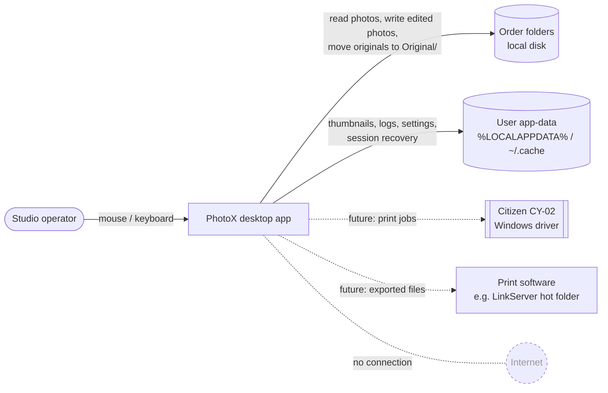
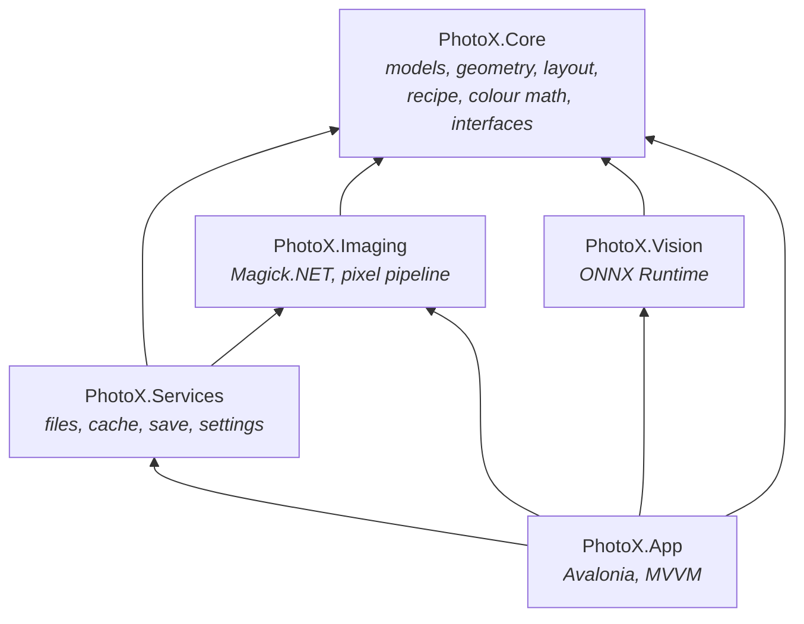
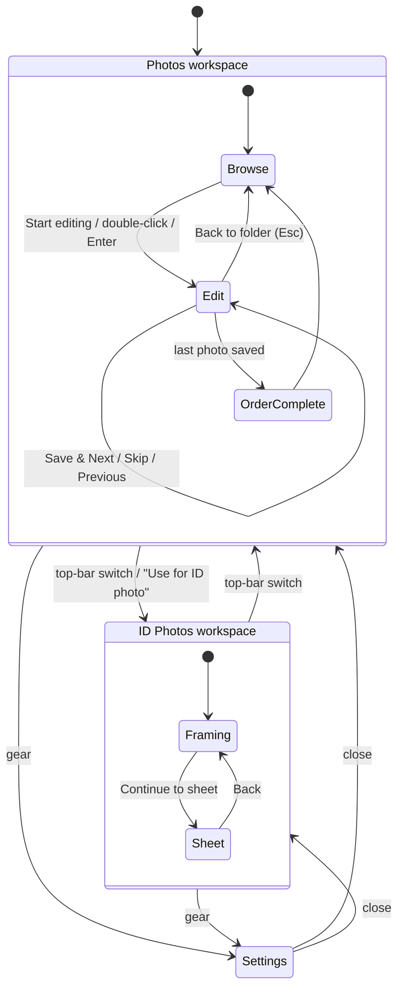
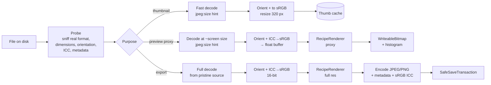
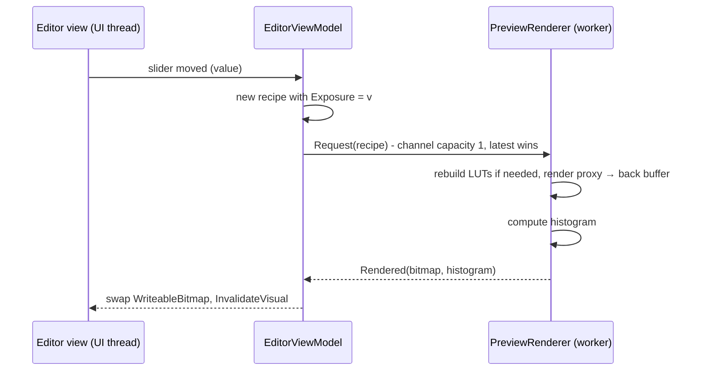
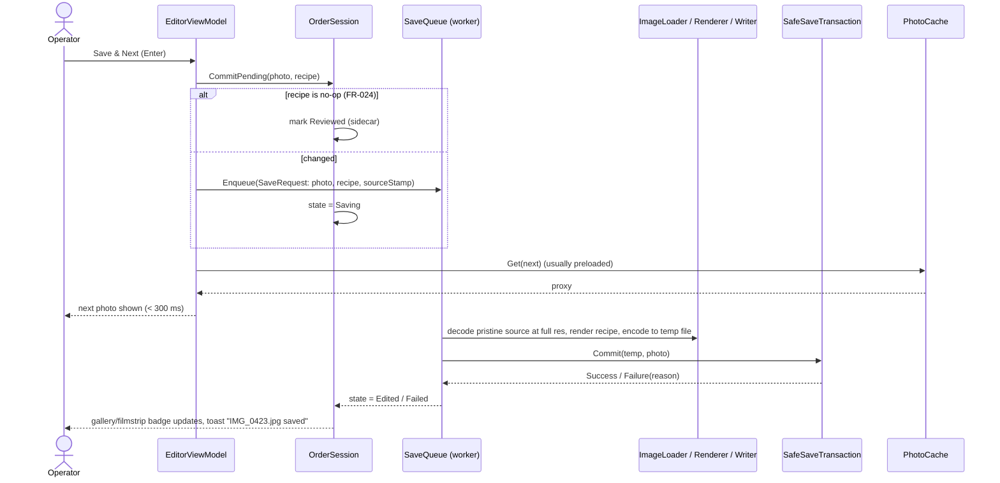
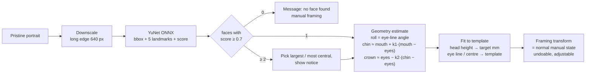
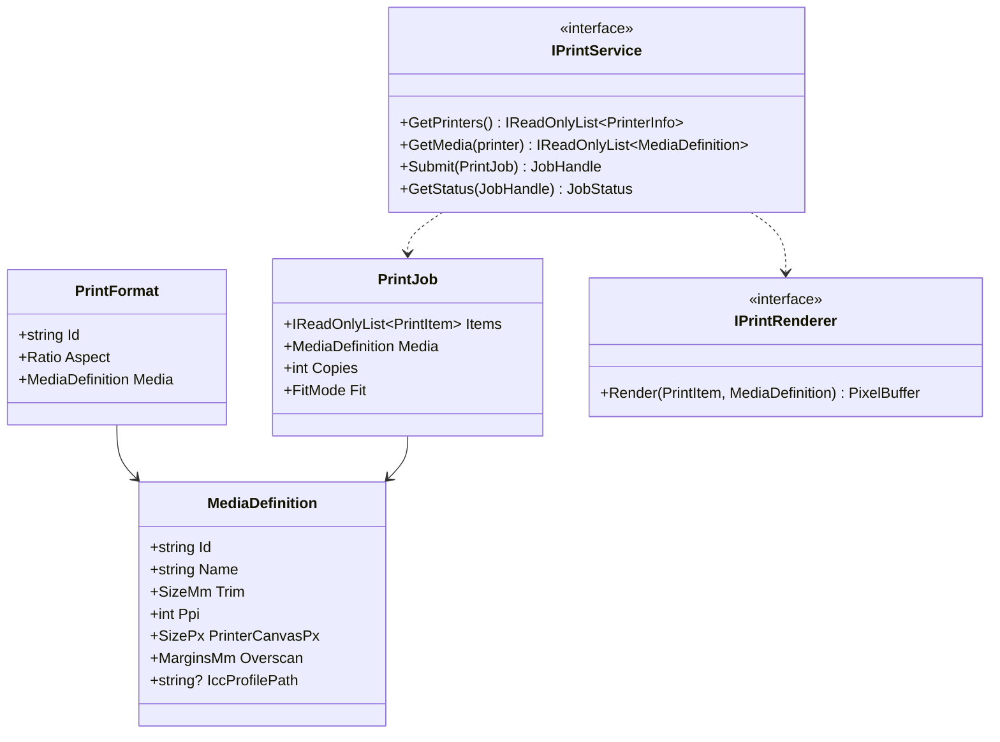

# PhotoX — Architecture

| | |
|---|---|
| **Status** | PROPOSAL for owner review (plan revision P-1, 2026-10-29). Nothing is implemented. |
| **Authority** | Requirements live in [PLAN.md](PLAN.md) and are referenced here by ID (FR-/NFR-). This document explains *how*. |
| **Decision markers** | **[Final-candidate]**: the owner prescribed it, or no credible alternative exists; it becomes final when the plan is approved. **[Proposal]**: the planner's recommendation; the owner may change it. **[Open → OQ-xxx]**: depends on an open question. |

---

## 1. Architectural principles

1. **Reliability before features.** Every file operation that touches customer photos goes through one audited, fault-injection-tested component (§9).
2. **One processing path.** Preview and export use the same parametric edit description (`EditRecipe`) and the same processing code. What the operator sees is what is saved (NFR-006).
3. **Edits are parameters, not pixels.** Undo, re-edit without degradation, session recovery and future batch operations all fall out of this.
4. **Core logic without UI.** Geometry, colour math, layout and the save transaction are plain .NET libraries with no Avalonia references, and are unit-tested on Linux and Windows.
5. **Modest structure.** A handful of projects with clear dependency rules. No plugin systems, no microservices, no message buses.
6. **Offline by construction.** No component opens network connections (NFR-001).

---

## 2. Technology choices and validation

All versions were checked on **2026-10-29** and must be re-checked when 0.1.0 starts. Versions are pinned centrally in `Directory.Packages.props`.

| Area | Choice | Version (researched) | License | Status | Notes |
|---|---|---|---|---|---|
| Runtime / language | .NET 10, C# 14 | SDK 10.0.4xx, runtime 10.0.14 | MIT | **[Final-candidate]** (owner) | LTS, supported until **2028-11-14**. .NET 11 (STS) is due Nov 2026; staying on LTS is recommended. |
| UI framework | Avalonia UI | **12.1.x** (12.0 released 2026-04-07) | MIT | **[Final-candidate]** (owner) | v12 changes: compiled bindings by default, DevTools moved to a separate (paid-tier) package, headless tests on xUnit v3. **Avoid** `TreeDataGrid` (now commercial) and `DataGrid` (deprecated). PhotoX needs neither. |
| Rendering | Avalonia/Skia (SkiaSharp 3.119.x, transitive) | — | MIT | **[Final-candidate]** | `WriteableBitmap` for previews. Do **not** add packages that pull in SkiaSharp 4.x (version conflict). |
| MVVM | CommunityToolkit.Mvvm | 8.4.x | MIT | **[Proposal]** | Current default of the Avalonia template. Source generators (`[ObservableProperty]`, `[RelayCommand]`). Simpler than ReactiveUI for agent-maintained code. |
| DI / config / logging abstractions | Microsoft.Extensions.DependencyInjection, .Logging | 10.0.x | MIT | **[Proposal]** | Composition root only. No generic host. |
| Image I/O and colour | **Magick.NET-Q16-x64** | **15.x** (ImageMagick 7.1.2, lcms 2.19) | Apache-2.0 + ImageMagick licence (+ LGPL components inside the native library, see §2.2) | **[Final-candidate]** (owner); Q16 variant **[Proposal]** | One package contains `win-x64` and `linux-x64` natives. Q16 gives 16-bit headroom for ICC conversion and 16-bit PNG. Q8 is the fallback if memory proves tight. Magick.NET 15 renamed several APIs (`Orientation`, `ColorProfiles`), so use 15.x from the start. |
| Pixel adjustments | Own managed code (`System.Numerics.Vector<T>`, `Parallel.For`) | — | — | **[Proposal]** | Tone and colour math is ours: deterministic, testable, identical for preview and export (§7.5). |
| Logging backend | Serilog + Serilog.Extensions.Logging + Serilog.Sinks.File | 4.4 / 10.0 / 7.0 | Apache-2.0 | **[Proposal]** | MEL has no file provider. Code depends only on `ILogger<T>`. |
| Face detection | ONNX Runtime + **YuNet** model | ORT 1.3x; YuNet 2023mar | MIT / MIT | **[Proposal]** (0.7.0) | Five landmarks (eyes, nose, mouth corners). The model is 0.23 MB. Fallback: OpenCvSharp4 `FaceDetectorYN` (Apache-2.0). See §11.4. |
| Background matting | ONNX Runtime + **MODNet** | official ONNX | Apache-2.0 (code and weights) | **[Proposal]** (0.7.0, experimental) | Soft alpha, decent hair. Optional HQ: BiRefNet-portrait (MIT, slow, dataset terms unverified). |
| Unit/integration tests | xUnit v3 **pinned to 3.2.2** | 3.2.2 | Apache-2.0 | **[Proposal]** | `Avalonia.Headless.XUnit` 12.1.x **breaks with xUnit 4.x** (Avalonia issue #22072). Pin until it is fixed. |
| UI tests | Avalonia.Headless.XUnit | 12.1.x | MIT | **[Proposal]** | Headless rendering with `CaptureRenderedFrame()` for screenshot checks. |
| Assertions | Shouldly or plain xUnit asserts | — | BSD-3 | **[Proposal]** | **Avoid FluentAssertions 8+** (commercial licence). |
| Image comparison | Magick.NET `Compare` (PSNR, ΔE via Lab) | — | — | **[Proposal]** | Avoid `Verify.ImageMagick` (pulls `Q16-AnyCPU`, which duplicates the native packages) and ImageSharp-based comparers (Six Labors licence). |
| Installer / updates | **Velopack** (folder publish) | 1.2.x | MIT | **[Open → OQ-015]** | Alternatives: Inno Setup 7, MSIX. Avoid single-file publish (native-library extraction, see §15). |
| CI | GitHub Actions, `ubuntu-latest` (24.04), `windows-latest` (Server 2025) | `actions/setup-dotnet@v6` | — | **[Final-candidate]** (owner) | No display server needed (headless). |

### 2.1 Alternatives considered

| Alternative | Verdict | Reason |
|---|---|---|
| WPF / WinUI 3 | Rejected | Windows-only. Development and testing on Linux Mint would be impossible (owner requirement). |
| Uno Platform 6 | Viable, not better | Also cross-platform with a Skia renderer. No advantage for a single-window desktop tool, smaller desktop community, and the owner already chose Avalonia. |
| .NET MAUI | Rejected | No Linux desktop support. |
| ImageSharp instead of Magick.NET | Rejected | Six Labors Split License requires a paid licence for commercial closed-source use above revenue thresholds. Weaker ICC/metadata support. |
| SkiaSharp only | Rejected as primary | Weak metadata and ICC handling. It stays only for rendering, via Avalonia. |
| OpenCV (OpenCvSharp) for all imaging | Not needed | Very large native payload. Magick.NET covers I/O, colour and resampling better. Kept as the fallback for face detection. |
| ReactiveUI | Not chosen | More concepts than needed. Avalonia's own ReactiveUI package was discontinued after 11.3 (moved to the ReactiveUI team). |
| Emgu CV, dlib 68-point, InsightFace/SCRFD, FaceAiSharp bundle, FaceONNX models, BRIA RMBG, rembg default model | **Rejected (licensing)** | GPL/commercial dual licence, non-commercial model weights, or unknown provenance. See §2.2. |

**Conclusion:** the owner's preferred stack is suitable. No change is recommended. The additions (CommunityToolkit.Mvvm, Serilog, ONNX Runtime, Velopack) fill gaps the owner left open.

### 2.2 Licensing notes (input to OQ-013)

- **Magick.NET** is Apache-2.0. **ImageMagick's licence** requires shipping the licence and notice. The native library statically links several **LGPL** components (libheif, libde265, libraw, glib, pango, librsvg, fribidi, liblqr, as listed in its `Notice.txt`). PhotoX calls it as a separate replaceable native library (P/Invoke), and the full source of Magick.Native is public. Shipping `Notice.txt`, the licence texts and a source pointer is believed to be sufficient. **Recommend a short legal check before 1.0.**
- **HEVC/HEIC** decoding (libde265) may carry patent-pool implications. This is one reason HEIC is deferred (OQ-004).
- **Model weights** need their own licence check. YuNet: MIT. MODNet: Apache-2.0. MediaPipe models: Apache-2.0; conversion to ONNX is a derivative work, so keep the NOTICE. Rejected weights: InsightFace (non-commercial), dlib 68-point (dataset restriction), BRIA RMBG 1.4/2.0 (non-commercial).
- **Avalonia** is MIT. Paid tiers (DevTools, Hot Reload, TreeDataGrid and others) are **not needed**. The Avalonia pricing FAQ suggests paid tiers for commercial use of those *tools* only.
- A `THIRD-PARTY-NOTICES.md` is generated and shipped from 0.1.0 onward.

---

## 3. System context



---

## 4. Repository and solution structure

**[Proposal]** Created in milestone 0.1.0, not now.

```text
PhotoX/
├── PhotoX.slnx                     # .NET 10 XML solution format
├── global.json                     # pins the .NET 10 SDK feature band
├── Directory.Build.props           # Version (0.1.0), nullable, warnings-as-errors, analyzers
├── Directory.Packages.props        # central package versions (all pinned)
├── src/
│   ├── PhotoX.Core/                # domain model and pure algorithms; no I/O, no UI, no native deps
│   ├── PhotoX.Imaging/             # Magick.NET-based decode/encode/colour/metadata + managed pixel pipeline
│   ├── PhotoX.Services/            # application services: folders, thumbnails, preload, save transaction, settings, session
│   ├── PhotoX.Vision/              # (0.7.0) ONNX Runtime face detection and portrait matting
│   └── PhotoX.App/                 # Avalonia app: views, view models, localization, composition root
├── tests/
│   ├── PhotoX.Core.Tests/
│   ├── PhotoX.Imaging.Tests/
│   ├── PhotoX.Services.Tests/      # includes save-transaction fault injection
│   ├── PhotoX.Vision.Tests/        # (0.7.0)
│   ├── PhotoX.App.Tests/           # Avalonia.Headless UI and workflow tests
│   └── PhotoX.TestKit/             # synthetic fixture generators, fake file system, comparers
├── assets/
│   ├── defaults/                   # print-formats.json, id-templates.json
│   └── models/                     # (0.7.0) ONNX models + their LICENSE files
├── tools/                          # dev scripts (fixture generation, notices)
├── docs/                           # this documentation
└── .github/workflows/ci.yml
```

### 4.1 Dependency rules



- `Core` references nothing except the BCL. Interfaces implemented elsewhere (`IFaceDetector`, `IPrintService`, `IFileSystem`) are declared here.
- `Imaging` and `Vision` never touch the file system policy (backup, journal). They read and write the streams they are given.
- `Services` owns every write into customer folders. **No other project may write into an order folder.** This is enforced by code review and an architecture test that scans for forbidden `System.IO` usage.
- `App` contains no image math and no file operations. It only calls services.

---

## 5. Component responsibilities

| Component (project) | Responsibilities | Key types (indicative) |
|---|---|---|
| Domain model (Core) | Edit parameters, print formats, ID templates, order state, sheet layouts | `EditRecipe`, `NormalizedRect`, `PrintFormat`, `MediaDefinition`, `IdTemplate`, `PhotoState`, `SheetLayout` |
| Geometry (Core) | Crop math, ratio constraints, rotation bounds, effective ppi, mm↔px | `CropCalculator`, `RotationBounds`, `Units` |
| Colour and tone math (Core) | Tone LUT construction, WB gains, saturation, histogram statistics, Auto Correct estimation | `ToneCurveBuilder`, `WhiteBalance`, `HistogramStats`, `AutoCorrectEstimator` |
| Layout engine (Core) | ID sheet arrangements and validation | `SheetLayoutEngine` |
| Decoder (Imaging) | Format sniffing, decode, EXIF orientation, ICC → sRGB, metadata capture, proxy decode | `ImageLoader`, `ImageInfo`, `SourceImage` |
| Renderer (Imaging) | Applies `EditRecipe` to a proxy or full-resolution source (geometry plus LUT pipeline) | `RecipeRenderer`, `PixelBuffer` |
| Encoder (Imaging) | JPEG/PNG encoding, metadata write-back, DPI, sRGB profile embed | `ImageWriter`, `EncodeOptions` |
| Thumbnails (Services) | Prioritised background generation and disk cache | `ThumbnailService`, `ThumbnailCache` |
| Folder browsing (Services) | Drives, folders, photo enumeration, removable/read-only detection, change watching | `LocationService`, `FolderScanner` |
| Order state (Services) | Sidecar (saved recipes, reviewed marks), state derivation, session recovery file | `OrderStore`, `SessionStore` |
| Preload cache (Services) | Decoded proxies for current ±2 photos, memory budget | `PhotoCache` |
| Save pipeline (Services) | Background queue, full-res render, safe-save transaction, journal, recovery | `SaveQueue`, `SafeSaveTransaction`, `RecoveryService` |
| Settings (Services) | Load/validate/migrate/save JSON settings and defaults | `SettingsService` |
| Vision (Vision) | Face detection with landmarks, portrait alpha matte | `YuNetFaceDetector`, `ModNetMatting` |
| Shell and navigation (App) | Main window, workspace switching, language switching, settings overlay | `ShellViewModel`, `INavigator` |
| Photos workspace (App) | Browser (explorer plus gallery) and editor view models | `BrowserViewModel`, `EditorViewModel`, `CropOverlayViewModel` |
| ID workspace (App) | Framing and sheet view models | `IdFramingViewModel`, `IdSheetViewModel` |
| Localization (App) | Runtime language switching, culture formatting | `Localizer`, `TrExtension` |

### 5.1 Important interfaces (indicative C#, for review only)

```csharp
// PhotoX.Core: the complete description of an ordinary-photo edit. Immutable; equality = "no change".
public sealed record EditRecipe(
    int QuarterTurns,               // 0..3 clockwise, applied after EXIF orientation
    double StraightenDegrees,       // -10..+10
    NormalizedRect Crop,            // in the rotated+straightened image, 0..1 coordinates
    string? FormatId,               // e.g. "4x6"; null = custom/free
    double ExposureEv,              // -2..+2
    double Contrast,                // -100..+100
    double Saturation,              // -100..+100
    double Temperature,             // -100..+100 (warm > 0)
    Levels Levels)                  // black, midtone gamma, white
{
    public static EditRecipe Identity { get; } = /* full-frame crop, all zero */;
    public bool IsNoOp => this == Identity with { FormatId = FormatId };
}

public interface IImageLoader
{
    ImageInfo Probe(Stream file);                                          // real format, size, orientation, profile
    Task<SourceImage> LoadAsync(Stream file, LoadOptions options, CancellationToken ct); // proxy or full
}

public interface IRecipeRenderer
{
    PixelBuffer Render(SourceImage source, EditRecipe recipe, RenderTarget target); // same code for proxy and full
}

public interface ISaveQueue
{
    SaveTicket Enqueue(SaveRequest request);       // returns immediately; observe ticket for result
    Task DrainAsync(CancellationToken ct);        // on app close
}

public interface IFileSystem                      // thin seam used ONLY by the save transaction & order store,
{                                                 // so tests can inject faults at every step
    Stream CreateNew(string path, FileOptions options);
    void Move(string from, string to, bool overwrite);
    void Replace(string source, string destination);
    void Flush(Stream s);
    /* … exists, delete, attributes, free space … */
}

public interface IFaceDetector  { Task<IReadOnlyList<FaceDetection>> DetectAsync(PixelBuffer image, CancellationToken ct); }
public interface IPortraitMatting { Task<AlphaMask> EstimateAsync(PixelBuffer image, CancellationToken ct); }
public interface ISheetLayoutEngine { IReadOnlyList<SheetLayout> Enumerate(SheetRequest request); }
public interface IPrintService { /* future — §13 */ }
```

---

## 6. Application composition, navigation and state

### 6.1 Composition

`Program.Main` → `AppBuilder` (Avalonia 12, Skia, HarfBuzz) → `App.OnFrameworkInitializationCompleted`:

1. Build the DI container (singletons for services and caches, transients for view models).
2. Configure Serilog. Install global exception handlers (§14).
3. Load settings, initialize the `Localizer` with the saved language.
4. Run `RecoveryService` for the last opened folder (§9.5).
5. Show `MainWindow` with `ShellViewModel`.

View resolution: a `ViewLocator` maps `XxxViewModel` → `XxxView` (Avalonia convention). Navigation is view-model-first: the shell holds a `CurrentWorkspace`, and each workspace holds its own current page.

### 6.2 Navigation structure



Switching workspace never discards work: the Photos session (current photo and pending recipes) and the ID session stay in memory.

### 6.3 Application state

| State | Owner | Lifetime | Persistence |
|---|---|---|---|
| Settings (language, formats, quality…) | `SettingsService` | App | `settings.json` |
| Current order (folder, photo list, per-photo state) | `OrderSession` | Until folder change | Derived from disk + `Original/.photox-order.json` |
| Pending edits (unsaved recipes + undo history) | `OrderSession` → `PhotoEditState` | Session | Recipes only, in session-recovery file (debounced 1 s) |
| Save queue | `SaveQueue` | App | Journal on disk during each transaction |
| Decoded proxies | `PhotoCache` | LRU | none |
| Thumbnails | `ThumbnailCache` | Disk LRU | cache folder |
| ID session (source, template, framing, adjustments, layout options) | `IdSession` | Session | session-recovery file |

View models observe these objects. They do not own data that must survive a view change.

---

## 7. Image processing pipeline

### 7.1 Overview



### 7.2 Decode and normalisation (Imaging)

1. **Probe** reads only the header. The real format comes from magic bytes (`FF D8 FF` = JPEG, `89 50 4E 47` = PNG); the extension is ignored (FR-030). It also reads dimensions, EXIF orientation, embedded ICC profile, bit depth and colour type (CMYK JPEG, 16-bit PNG, palette PNG).
2. **Guards:** `ResourceLimits` caps width, height and area (210 MP), memory and threads (decompression-bomb protection, FR-036/FR-037). Zero-byte or truncated files produce a typed `ImageLoadError`.
3. **Decode.** Proxy and thumbnail decodes pass `jpeg:size` (≥ 2× target), so libjpeg DCT-scales during decode. This is 4–10× faster and uses far less memory. Export always decodes at full resolution.
4. **Orientation.** `AutoOrient()` applies EXIF orientation to the pixels. The metadata model then records Orientation = 1 (FR-032).
5. **Colour.** If an ICC profile is present and is not sRGB, transform to sRGB with LittleCMS (relative colorimetric intent with black-point compensation, proposal; perceptual is the alternative). With no profile, assume sRGB. CMYK JPEGs use their embedded profile or a generic CMYK profile, then go to sRGB. PNG `gAMA`/`cHRM`/`sRGB`/`iCCP` chunks are honoured (FR-034).
6. **Buffer.** The result is converted to a managed `PixelBuffer` of float32 RGB in sRGB encoding, range 0–1. Alpha is kept separately for PNG.

### 7.3 Working representations

| Buffer | Size | Typical memory | Use |
|---|---|---|---|
| Thumbnail | 320 px long edge, 8-bit | < 0.3 MB | gallery |
| Preview proxy | long edge = min(source, max(2560, screen long edge × scale)) | 2560×1707 × 3 × 4 B ≈ 52 MB | editor |
| Display bitmap | proxy size, BGRA8 | ≈ 17 MB | `WriteableBitmap` |
| Full-resolution source | native | 24 MP: ≈ 290 MB float (rendered in row bands, see §15) | export only, transient |

### 7.4 Geometry

Order of operations: **EXIF orientation → quarter turns → straighten → crop.**

- **Quarter turns** are exact pixel transposes (lossless).
- **Straighten** rotates by θ around the image centre. The crop must stay inside the rotated image's valid area. For a rotated W×H image, the valid region is the original rectangle rotated by θ. `CropCalculator.ConstrainToRotated` keeps all four crop corners inside it. The largest crop of a given ratio is found by closed-form inscribed-rectangle math, so there are no empty corners.
- **Crop** is stored as a `NormalizedRect` in the rotated-and-straightened image space, so the same recipe applies to a 2560 px proxy and a 6000 px original. At export it becomes integer pixels by rounding the edges, not the width. The ratio error from rounding is bounded at ±0.5 px per edge, and a test verifies it.
- **Default crop** (FR-003) is the largest centred rectangle of the preset ratio, with orientation matching the image (portrait if H > W).
- **Effective ppi** = crop long-edge pixels ÷ physical long edge in inches of the selected `PrintFormat`. It drives the low-resolution warning (FR-047) and the DPI metadata.
- **Preview of geometry.** While a crop handle or the straighten slider is being dragged, the display uses a GPU render transform of the existing proxy bitmap: instant, approximate. Exact resampling of the proxy runs when input stops (≈ 100 ms idle). Export always resamples exactly with Magick (`Distort ScaleRotateTranslate`, Lanczos or Mitchell filter; filter choice validated in TS-06).

### 7.5 Tone and colour operations

All of these are **per-pixel and resolution-independent**, so proxy and export give identical results. The order is fixed:

| # | Operation | Space | Formula (proposal; tuned in 0.4/0.5 against reference images) |
|---|---|---|---|
| 1 | Linearise | sRGB → linear | standard sRGB EOTF (LUT) |
| 2 | White balance | linear RGB | per-channel gains from `Temperature` (blue↔amber axis). Gains are normalised to keep Rec.709 luminance constant. |
| 3 | Exposure | linear RGB | multiply by 2^EV |
| 4 | Re-encode | linear → sRGB | inverse EOTF (LUT) |
| 5 | Levels | sRGB-encoded | v' = clamp((v − b)/(w − b))^(1/γ) |
| 6 | Contrast | sRGB-encoded | S-curve around 0.5 with strength c (symmetric, monotonic, endpoints fixed) |
| 7 | Saturation | sRGB-encoded | Y = luma(v); v' = Y + (v − Y)·(1 + s), with soft limit to avoid clipping |
| 8 | Clamp / quantise | — | to 8-bit (JPEG) or 16-bit (PNG 16) with round-half-even |

Steps 1–6 are per channel, so they are **baked into three 1D LUTs** (4096 entries with linear interpolation) whenever the recipe changes. The per-pixel cost is then three LUT lookups plus one saturation mix: SIMD-friendly, about 30 ms on a 4 MP proxy and about 300 ms on 24 MP with 4 cores (estimates to verify in TS-11).

### 7.6 Auto Correct

The goal is a natural and conservative result that is fully editable afterwards (FR-045). It runs on the **cropped proxy before tone operations**.

1. Build a 1024-bin luminance histogram, ignoring pixels that are clipped in every channel.
2. **Range:** black = 0.1st percentile, capped at 0.06. White = 99.8th percentile, floored at 0.88. If the image already spans ≥ 0.95 of the range, leave levels unchanged.
3. **Brightness:** compare the median luminance after the new levels with a target of 0.46. Apply 60 % of the needed correction as `ExposureEv`, clamped to ±1 EV.
4. **Colour cast:** grey-world estimate over **mid-tone, low-saturation pixels only**. Exclude the skin-tone hue band (≈ 5°–50° hue, moderate saturation) and highlights/shadows. Correct 50 % of the estimated cast, clamped to ±25 temperature units. Skip if fewer than 5 % of pixels qualify.
5. Write the results into the recipe as ordinary values: `Levels.Black/White`, `ExposureEv`, `Temperature`. One undo step.

No histogram equalisation or per-channel stretching is used, because these cause the skin-tone and colour shifts the owner wants to avoid. The algorithm is validated on a 50-photo reference set by owner rating (TS-04/TS-19).

**Bulk Auto Correct (FR-046, deferred):** because the result is just recipe values, a batch command can compute a recipe per selected photo, queue them as *pending* (unsaved) edits for quick review, and let Save & Next confirm each one. No architectural change is needed.

### 7.7 Histogram

- Computed from the **rendered proxy inside the crop**, so it reflects the output (FR-043): 256 bins for R, G, B and luminance (Rec.709 on encoded values).
- Computed on a worker thread after each render and throttled to 20 Hz while dragging. Rendered as polylines with a translucent luminance area (see mockup 02).
- The levels handles on the histogram edit `Levels` directly.

### 7.8 Preview rendering loop



Rendering never runs on the UI thread. Rapid input is coalesced, and an in-flight render is never queued twice.

### 7.9 Export encoding and metadata

| Item | Policy (proposal; OQ-005, OQ-012, OQ-020) |
|---|---|
| Format | Same as source: JPEG → JPEG, PNG → PNG (FR-030) |
| JPEG | quality 95, chroma 4:4:4 (`jpeg:sampling-factor=1x1`), optimised Huffman, progressive off, all configurable |
| PNG | lossless. 16-bit sources keep 16-bit; alpha kept. |
| Colour | pixels in sRGB with a compact sRGB ICC profile embedded |
| EXIF | copied. Orientation = 1. PixelX/YDimension updated. Embedded EXIF thumbnail removed (stale). `Software` = `PhotoX 0.x`. GPS kept by default (OQ-020). |
| IPTC / XMP | copied. XMP `tiff:Orientation` updated, `xmp:ModifyDate` set. |
| DPI (density) | effective ppi of the selected print format, so other software prints at the intended size (OQ-005) |
| File timestamps | new file gets the current time; the backup keeps the original timestamps (it is moved, not copied) |

### 7.10 Edit → save sequence



---

## 8. Folder browsing, thumbnails and preloading

### 8.1 Locations and folders (FR-001, FR-054)

- **Drives:** `DriveInfo.GetDrives()` filtered to ready Fixed and Removable drives. On Linux, also mount points under `/media/$USER`, `/run/media/$USER` and `/mnt`, plus the home folder. Removable drives get a USB icon and the removable-media warning.
- **Folder tree:** lazy-loaded, hiding hidden/system folders and `Original`. Folders are sorted in natural order.
- **Recent orders:** the last 10 folders with cached progress counts, stored in settings.
- **Watching:** a `FileSystemWatcher` on the current folder (non-recursive) picks up photos added later. Events are debounced. The watcher is never trusted for correctness; a rescan happens on focus.

### 8.2 Photo enumeration

- Include `*.jpg|*.jpeg|*.jpe|*.png` case-insensitively, plus files with other extensions whose magic bytes say JPEG/PNG (shown with a format-mismatch badge, FR-030).
- Exclude hidden files, `.photox-*` and `*.photox-tmp` files, and the `Original` folder.
- Natural sort (`IMG_2` before `IMG_10`) by default. Optional sort by date taken (EXIF), which needs a probe pass.
- Each photo's state comes from §9.6.

### 8.3 Thumbnail service (FR-053)

- **Priority queue:** visible cells first, then neighbours, then the rest. Work for a previous folder is cancelled. Parallelism is `min(4, cores − 1)`, and Magick thread limits prevent oversubscription.
- **Instant placeholder:** if the JPEG contains an EXIF thumbnail, show it oriented while the real one is generated.
- **Cache key:** SHA-256 of (normalised full path, file size, last-write UTC, generator version). Files live at `%LOCALAPPDATA%\PhotoX\cache\thumbs\ab\<hash>.jpg` (Linux: `$XDG_CACHE_HOME/PhotoX/thumbs`). Saving a photo changes its key, so the thumbnail regenerates.
- **Limits (NFR-012):** 1 GB size cap with LRU eviction, entries older than 30 days purged at startup, and *Clear cache* in Settings (OQ-018).

### 8.4 Preload cache (FR-052)

- `PhotoCache` holds decoded proxies for the current photo and ±2 neighbours in sequence order, within a memory budget (default 400 MB). The least recently used entry is evicted first.
- When the editor opens photo *i*, the cache requests *i+1* (high priority), then *i−1*, *i+2* and *i−2*. A jump cancels outstanding preloads.
- Full-resolution data is **never** cached. It is decoded transiently by the save worker.

---

## 9. Saving, backup and recovery

This is the most safety-critical component (FR-005, FR-021–FR-027, NFR-005). It lives in `PhotoX.Services`, uses only the `IFileSystem` seam, and is tested with fault injection at every step (TS-08).

### 9.1 Files PhotoX creates in an order folder

```text
CustomerOrder/
  IMG_001.jpg                         ← edited version (after first save)
  IMG_002.jpg
  .IMG_003.jpg.1a2b3c4d.photox-tmp    ← transient, only during a save (hidden)
  Original/                           ← hidden from the gallery and the explorer tree
    IMG_001.jpg                       ← untouched original (moved, timestamps kept)
    .photox-order.json                ← sidecar: saved recipes, reviewed marks, backup mapping (hidden)
    .photox-journal.json              ← exists only while a transaction is in flight (hidden)
```

**[Open → OQ-009]** All PhotoX metadata lives inside `Original/`, so the order root contains nothing but photos and the `Original` folder.

### 9.2 Save transaction

Preconditions are checked before encoding (FR-023):

- the source still has the size and last-write time it had when loaded;
- the folder is writable;
- the file is not read-only;
- free space ≥ 2 × the estimated output size + 50 MB;
- on Windows, path length is supported (the app manifest declares `longPathAware`).

**First save of `X`** (no backup yet):

| Step | Action | Durable state afterwards |
|---|---|---|
| S1 | Render full-res from the **pristine source** (`X`), encode to temp `T` = `.X.<rand>.photox-tmp` in the same folder (`FileOptions.WriteThrough`), `Flush(true)` | `X` original, `T` new |
| S2 | **Verify** `T`: decode it fully, check format and dimensions. On failure, delete `T` and abort. | unchanged |
| S3 | Create `Original/` if missing. Write journal `{op: first-save, X, T, backup: Original/X, sourceStamp}` atomically. | journal present |
| S4 | **Rename `X` → `Original/X`** (same volume, atomic, *fails if the target exists*) | `X` missing, backup present, `T` present |
| S5 | **Rename `T` → `X`** (atomic) | `X` new, backup present |
| S6 | Update sidecar atomically (write temp, replace) with the recipe, backup mapping and output stamp | |
| S7 | Delete journal; report success | done |

**Subsequent save of `X`** (backup exists): the pristine source is `Original/X`. S1–S3 are the same with `op: replace`. S4 is skipped. S5 becomes an **atomic replace** of `X` by `T`: `File.Replace` on Windows, which preserves the creation time and ACL, and `rename(2)` on Linux. Then S6 and S7.

**Invariant (checked by TS-08 at every injected fault):** at every instant the original's bytes exist completely, at `X` or at `Original/X`, and `X` is either the old file, the complete new file, or absent with a verified `T` ready to be renamed.

Transient failures caused by antivirus, indexers or cloud-sync locks (sharing violations) are retried three times over about 1 s with backoff before reporting a failure.

### 9.3 Failure handling

| Failure | Behaviour |
|---|---|
| Encode fails / disk full at S1 | delete `T`; photo → Failed; message “Not enough disk space…” (localized); edits kept |
| Verification fails at S2 | delete `T`; Failed; log details; edits kept |
| Rename fails at S4 (target exists) | collision path (§9.4) |
| Rename fails at S5 | journal remains; immediate in-process recovery attempt; otherwise the recovery service completes it on the next folder open |
| Crash or power loss anywhere | recovery on next start (§9.5) |

### 9.4 Collisions and special cases

| Case | Policy |
|---|---|
| `Original/X` exists and the sidecar maps it to `X` | Normal subsequent save. The backup is never touched. |
| `Original/X` exists but the sidecar does not know it (older edits, sidecar lost, manual copy) | **[Open → OQ-007, default]** Treat it as `X`'s backup and never overwrite it. The pristine source becomes the *current* `X`, since the recipe is unknown, and the UI notes “previously edited outside this session”. |
| Backup name taken by an unrelated file, or a case-only clash on Linux (`img.JPG` vs `IMG.jpg`) | Back up as `Original/X (2).ext` (next free number) and record the mapping in the sidecar. Never overwrite. |
| Name comparison | always case-insensitive (Windows semantics on every OS) and Unicode-normalised (NFC) |
| `Original` exists as a *file* | Abort with a clear message. Nothing changed. |
| Source changed externally since load | Refuse to save. Offer “Reload photo” (edits can be re-applied because the recipe is kept). |
| Source deleted externally | Failed; offer “Save as new file” (proposal) |
| Format/extension mismatch | Write the same format as the content and keep the filename (FR-030). Log a warning. |
| Read-only file or folder | Refuse with a clear message. PhotoX never changes attributes itself. |
| Removable or network location | Warn on folder open (FR-054). Saving is allowed. |

### 9.5 Recovery (crash-safe restart)

Runs when a folder is opened (including the last folder at startup), **before** the gallery shows states:

| Journal | `X` | `Original/X` | `T` | Interpretation | Action |
|---|---|---|---|---|---|
| first-save | original | absent | present | crash before S4 | delete `T`, delete journal (nothing changed) |
| first-save | absent | present | present, verifies | crash between S4 and S5 | rename `T` → `X`, update sidecar, delete journal |
| first-save | absent | present | missing or invalid | crash between S4 and S5, temp lost | **restore**: rename `Original/X` → `X`, delete journal, log error |
| first-save | new | present | absent | crash after S5 | update sidecar, delete journal |
| replace | old edit | present | present, verifies | crash before replace | complete the replace (the operator's intent was to save), update sidecar |
| replace | new | present | absent | crash after replace | update sidecar, delete journal |
| none | any | any | stray `*.photox-tmp` > 10 min old | abandoned temp | delete it |

Every recovery action is logged and summarised to the operator in one non-modal notice (“1 interrupted save was completed”).

### 9.6 Photo state derivation

```text
state(X) =
  Failed      if session.lastSaveFailed(X)
  Saving      if saveQueue.contains(X)
  Unsaved     if session.pendingRecipe(X) != saved recipe
  Edited      if backupOf(X) exists                        (Original/X or mapped name)
  Reviewed    if sidecar.reviewed(X) and stamp(X) matches
  Error       if probe(X) failed
  To do       otherwise
```

### 9.7 Revert and re-edit

- **Re-edit (FR-026):** load the pristine source `Original/X` and the saved recipe from the sidecar. Saving again re-renders from the pristine source, so the result is one JPEG generation from the original.
- **Revert (FR-025):** after confirmation, a journalled transaction replaces `X` with the backup's bytes (rename backup → `X` over the edited file) and removes the sidecar entry.

---

## 10. Undo/redo and session

- Every photo in the session has a `PhotoEditState { EditRecipe Saved; List<EditRecipe> History; int Index; }`.
- An edit appends a recipe. Slider drags and crop drags commit **one** step on pointer release, and keyboard nudges are coalesced over 500 ms. History holds at most 100 steps and is kept in memory only.
- Undo and redo just move `Index`. The preview re-renders from the recipe. Undo after a save is allowed: it creates a new unsaved state.
- The **session-recovery file** (`%LOCALAPPDATA%\PhotoX\session\<folder-hash>.json`) stores the pending recipe per photo, written atomically and debounced to 1 s. After a crash, re-opening the folder offers “Restore 3 unsaved edits?”. This is the only startup prompt.

---

## 11. ID Photo Creator

### 11.1 Templates (FR-061)

Templates are JSON data, shipped in `assets/defaults/id-templates.json` and overridable in Settings:

```json
{
  "id": "35x45",
  "name": { "en": "3.5 × 4.5 cm", "ro": "3,5 × 4,5 cm" },
  "widthMm": 35, "heightMm": 45,
  "guides": {
    "headHeightMm": [32, 36],
    "eyeLineFromBottom": [0.50, 0.70],
    "crownMarginMm": [2, 6]
  },
  "background": "light",
  "complianceNote": "Geometric preset only - not a statement of compliance with any document."
}
```

Default guide values follow common ISO/IEC 19794-5 / ICAO practice for 35×45 mm: head 70–80 % of the height, eye line at 50–70 % from the bottom. Templates for 3×4, 5×5 and 9×12 scale the same proportions until the owner supplies specific rules (OQ-011).

**Note from research (unconfirmed, OQ-011):** Romanian electronic passports and the electronic ID card capture the face photo live at the counter. Studio ID prints are therefore mostly for visas, foreign documents, permits and other cards, so templates must stay configurable rather than country-certified.

### 11.2 Framing model

The frame is fixed on screen. The source image moves underneath it. The state is a similarity transform `{ scale (source px per mm), rotationDeg, centre (source px) }`, plus the same tonal parameters as `EditRecipe` and `BackgroundLift`.

- **Render:** a single `Distort` (affine) from the **full-resolution pristine source** into the template's exact pixel size at the target ppi, with a Lanczos filter, followed by the managed tone pipeline. One resampling step, nothing cumulative.
- **Output pixel size** = round(mm × ppi / 25.4). For example 35×45 mm at 300 ppi = **413×531 px**.

### 11.3 Sheet-layout engine and validated example layouts (FR-066)

**Algorithm.** Inputs: page size (mm) and printable *safe area* (page minus minimum margins), photo size, spacing, whether photos may be rotated, whether the page may be landscape, and the requested copy count.

1. For each page orientation (portrait/landscape) and each photo rotation (0°/90°), compute `cols = ⌊(Wsafe + g)/(w + g)⌋` and `rows = ⌊(Hsafe + g)/(h + g)⌋`.
2. Each feasible (cols, rows) gives a capacity. For copy counts below capacity, generate compact sub-grids that fill row by row and stay centred.
3. Rank by capacity, then upright photos, then larger minimum margin. Margins below 3 mm get a *tight* warning; anything inside the expected printer overscan is flagged *unsafe*.
4. Positions are computed in **mm** and converted to pixels per edge, `round(x_mm × k)` with a fixed pixel width per photo. Every photo is therefore exactly `round(w×ppi/25.4)` px, with no accumulated drift.
5. Cut guides are 1 px grey lines in the gaps plus crop marks in the margins, never on a photo.

**Results** (computed for this plan; the layout engine must reproduce them in TS-15):

| Page / constraints | 3 × 4 cm | 3.5 × 4.5 cm | 5 × 5 cm | 9 × 12 cm |
|---|---|---|---|---|
| 4×6 in (101.6×152.4 mm), margin ≥ 3 mm, spacing 2 mm (**recommended default**) | **9** (3×3 portrait; margins 3.8 / 14.2) | **8** (4×2 landscape; margins 3.2 / 4.8) | **2** (1×2; margins 25.8 / 25.2) | **1** (margins 5.8 / 16.2) |
| 4×6 in, margin ≥ 4 mm, spacing 3 mm (generous) | **8** (4×2 landscape; 11.7 / 9.3) | **6** (2×3 portrait; 14.3 / 5.7) | **2** | **1** |
| 4×6 in, margin 0, spacing 0 (edge to edge, **not printable borderless**) | 10 (5×2) | 8 (4×2) | 6 (2×3; margins 0.8 / 1.2) | 1 |
| Nominal 100×150 mm, margin ≥ 3 mm, spacing 2 mm | 9 (3×3) | **6** (2×3) | 2 | 1 |

Findings: the owner's “eight 3×4” is improvable to nine. “Six 3.5×4.5” rises to eight on a true 4×6 page. “Up to six 5×5” is only geometrically possible edge to edge, which a borderless printer with about 1.8 mm overscan would trim, so the practical maximum is **two**. See [PLAN.md §8.3](PLAN.md#83-conflicts-and-tensions-found-in-the-originating-prompt).

### 11.4 Face detection and Auto Align (FR-063) [Proposal]



- **Why YuNet:** MIT code and weights, 0.23 MB, five landmarks, about 5 ms on CPU, and strong accuracy for frontal portraits.
- **Runtime:** ONNX Runtime (MIT, native win-x64/linux-x64), shared with background matting. The anchor decoding and NMS for YuNet's outputs are written in C# and unit-tested against reference outputs.
- **Crown and chin are estimated.** No permissive landmark model provides the crown. The constants `k1` and `k2` are calibrated on a labelled test set, and the operator always sees and can correct the guides. If chin estimation is too inaccurate, add MediaPipe FaceMesh V2 (Apache-2.0, converted to ONNX) for the chin and iris points.
- **Fallback:** OpenCvSharp4 `FaceDetectorYN` (Apache-2.0) if the custom ONNX integration proves fragile. Last resort: manual only.
- **Never automatic, never a compliance claim** (FR-063). A low score shows “Face uncertain, please check”.

### 11.5 Background (FR-064, FR-065)

- **Background brightness (manual, mask-free; 0.7.0):** lifts pixels that are bright, low in saturation and outside the expanded head oval, using a smooth weight. It works on uniform studio backdrops and degrades gracefully. It needs no ML.
- **Auto whiten (experimental):** MODNet (Apache-2.0) at 512×512 produces an alpha matte. The matte is upsampled with a guided filter at full resolution, edge colours are decontaminated, and the background is brightened through the matte towards the target tone (light grey or white) rather than cut out and replaced. Shipping requires passing the TS-13 visual rubric (OQ-010).
- **Documented limitations, shown in the UI:** fine or light hair against a light background, white or light-grey clothing, cast and contact shadows, colour spill, glasses reflections. Official requirements may also prohibit retouching. Responsibility stays with the operator.

### 11.6 Sheet export (FR-068, FR-070, FR-071)

- **Nominal canvas:** page mm × ppi, for example 4×6 at 300 ppi = **1200×1800 px**.
- **Printer-exact canvas** (from `MediaDefinition.PrinterCanvasPx`), for example CY-02 4×6 ≈ **1240×1844 px** (from Gutenprint driver tables; the canvas includes ≈ 1.7–1.9 mm overscan per side, unconfirmed). Photos are placed relative to the trimmed area, so printing the file 1:1 reproduces exact millimetres. A file printed “fit to page” is enlarged about 3 % on a borderless printer, which is why this matters (OQ-024).
- **Calibration page** (FR-071): rulers and reference rectangles at the same canvas, used to measure the real trim and scaling once per printer and media.
- Output is a new file next to the source, named `<source>_ID_<w>x<h>_<n>.jpg`, with a numbered suffix if it exists. It is never an overwrite.

---

## 12. Localization (FR-009)

- **Resources:** `Strings.resx` (English, neutral) and `Strings.ro.resx`, with a public generated class for compile-time keys.
- **Runtime switching:** Avalonia's resx `{x:Static}` pattern does **not** update on culture change, so PhotoX uses a `Localizer : INotifyPropertyChanged` singleton with an indexer, and a markup extension `{l:Tr SaveAndNext}` that binds to `Localizer.Instance[key]`. Switching language sets `CurrentUICulture`/`CurrentCulture` and raises `PropertyChanged("Item[]")`, so every bound string and formatted number updates live.
- **Cultures:** `ro-RO` (decimal comma, `12 oct. 2026`) and `en-GB` (metric-friendly English; proposal).
- **Fonts:** Avalonia's bundled Inter covers Romanian comma-below **ș ț** (U+0219/U+021B) and Ă Â Î. The app embeds Inter so rendering is identical on Windows and Linux.
- **Quality gates (TS-16):** key parity between languages, no unused keys, no literal UI strings in XAML or view models (analyzer test), and a pseudo-localization mode (+40 % length) to catch clipping.
- Adding a further language means adding one `.resx` file.

---

## 13. Future printing boundary (FR-050)

Nothing is implemented in 1.0. The boundary is defined now so that printing does not force a rewrite.



- **Reuse:** `MediaDefinition` and `PrintFormat` already drive crop presets, effective ppi, safe-area guides and ID sheets in 1.0, so print media selection plugs into the same data.
- **Implementation options, to be evaluated in a spike before the printing milestone:**
  - (a) Win32 printing (GDI/XPS) via CsWin32: full control over paper size, copies and spooler status.
  - (b) Citizen **LinkServer for Photo hot folder**: write correctly sized files to a watched folder. Simplest and robust; less status feedback.
  - (c) Gutenprint/CUPS on Linux for development testing only.
- **Colour:** sRGB to the driver by default. An optional printer ICC soft-proof/conversion step plugs in before `Submit`.
- A future `PhotoX.Printing.Windows` project references Core only. The app enables printing UI only when an `IPrintService` is registered.

---

## 14. Configuration, logging and error handling

### 14.1 Configuration (FR-040)

| File | Location (Windows / Linux) | Content |
|---|---|---|
| `settings.json` | `%APPDATA%\PhotoX\` / `$XDG_CONFIG_HOME/PhotoX/` | language, last folder, recent orders, JPEG quality, theme, cache limits, user overrides |
| `print-formats.json`, `id-templates.json` | shipped in `assets/defaults/`, user copies in the settings folder | media definitions, crop presets, ID templates |
| logs | `%LOCALAPPDATA%\PhotoX\logs\` / `$XDG_STATE_HOME/PhotoX/logs` | rolling logs |
| caches, session | `%LOCALAPPDATA%\PhotoX\cache\`, `…\session\` / `$XDG_CACHE_HOME/PhotoX/` | thumbnails, session recovery |

Settings carry a `schemaVersion` with forward migrations and are written atomically. An invalid file is renamed `settings.invalid-<date>.json`, defaults are used, and the operator sees a notice.

### 14.2 Logging and errors (FR-051)

- Serilog behind `ILogger<T>`: daily rolling files, 14 days, 10 MB per file. Information level by default, Debug available in Settings. **No image content or thumbnails in logs.** File paths are logged, since they are needed to diagnose saves.
- Global handlers: `AppDomain.UnhandledException`, `TaskScheduler.UnobservedTaskException` and Avalonia `Dispatcher.UIThread.UnhandledException`. These log, show a localized dialog with “Copy diagnostic info”, and attempt to drain the save queue.
- Errors that reach the UI are typed (`PhotoXError { Code, LocalizationKey, Args, Technical }`), so messages are always in the operator's language and in plain terms.

---

## 15. Performance and memory

| Concern | Approach |
|---|---|
| Large folders | virtualised gallery (`ItemsRepeater`/`VirtualizingStackPanel`), lazy probes, prioritised thumbnails |
| UI responsiveness | all decoding, rendering, hashing and I/O on worker threads; UI receives immutable results |
| Proxy decode speed | `jpeg:size` DCT scaling; preload neighbours |
| Full-res export memory | Magick Q16 decode (24 MP ≈ 190 MB) → managed float processing **in row bands** of 512 rows (≈ 30 MB working set) → encode. Peak about 450 MB at 24 MP and about 1.6 GB at 100 MP. Above 64 MP the queue runs one save at a time. |
| Very large images (64–210 MP) | allowed, with slower saves and a notice. Above 210 MP: refused (FR-037, OQ-016). |
| Parallelism | `Parallel.For` over row bands, capped at cores − 1; Magick thread resource limit set to match |
| Publish | framework-dependent or self-contained **folder** publish (not single-file), so native libraries (Magick, Skia, ONNX) load directly from the app folder without extraction to `%TEMP%` |
| Startup | target < 2 s to the main window (ReadyToRun compilation of app assemblies; evaluate Native AOT later, since Avalonia 12 supports trimming) |

---

## 16. Testing architecture

Testing is detailed in [TEST_PLAN.md](TEST_PLAN.md). Architectural enablers:

- `IFileSystem` lets TS-08 inject faults (exception or “crash”, meaning the process stops) before and after **every** step of §9.2.
- `TimeProvider` (BCL) is used for deterministic timestamps and debouncing in tests.
- `PhotoX.TestKit` generates synthetic fixtures at test time (gradients, colour checkers, EXIF orientation variants 1–8, ICC variants, corrupt files, unicode names). Only a few small binary fixtures are committed, and none of them are customer photos.
- Pure Core logic (geometry, layout, LUTs, Auto Correct estimation) is covered by property-based tests (FsCheck, BSD-3) where useful.
- An architecture test (reflection-based) enforces the §4.1 dependency rules.

---

## 17. Decision status summary

| Topic | Status | Decision / OQ |
|---|---|---|
| C# / .NET 10 / Avalonia / MVVM / Magick.NET / Git+GitHub | Final-candidate (owner) | DEC-001 … DEC-004 |
| Avalonia 12.x (not 11.x) | Proposal | DEC-002 |
| CommunityToolkit.Mvvm | Proposal | DEC-005 |
| Magick.NET Q16-x64 | Proposal | DEC-004 |
| Own managed tone pipeline (shared preview/export) | Proposal | DEC-006 |
| Edits stored as parameters plus sidecar for re-edit | Proposal | DEC-007, OQ-009 |
| Save transaction with journal; backup by move | Proposal (owner strategy + safety design) | DEC-008 |
| Background save queue | Proposal | DEC-009 |
| sRGB working and output space | Proposal | DEC-010, OQ-012 |
| JPEG q95, 4:4:4 | Proposal | OQ-005 |
| YuNet + ONNX Runtime; MODNet experimental | Proposal | DEC-011, OQ-010 |
| Serilog, xUnit 3.2.2 pin, Velopack | Proposal | DEC-012, DEC-013, OQ-015 |
| Printing via IPrintService boundary | Deferred (owner) | FR-050 |
