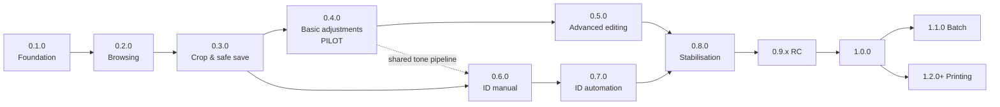

# PhotoX — Roadmap

Status: **proposal** (plan revision P-1, 2026-10-29). Implementation has **not** started and needs explicit owner approval. Requirement IDs refer to [PLAN.md](PLAN.md), and test suites (`TS-xx`) to [TEST_PLAN.md](TEST_PLAN.md).

## 1. Principles

- Every milestone produces something **runnable and testable**, and ends with its acceptance criteria met on **both** Linux and Windows CI.
- A milestone is complete only when its tests pass and the documentation is updated, not merely when its tasks are done.
- The riskiest parts (saving originals, image fidelity) come early so the owner can trial them on real orders as soon as possible.
- The owner's phases A–F are kept. Phase C is split in two (saving first, then adjustments) and phase E is split into a manual part and an ML part.

## 2. Milestones and version boundaries

| Version | Milestone | Owner phase | Size* | Outcome |
|---|---|---|---|---|
| — | **M0 Planning** (this deliverable) | — | — | Approved plan. No code. |
| **0.1.0** | M1 Foundation | A | M | App shell runs on Windows and Linux; EN/RO switching; settings; logging; CI green |
| **0.2.0** | M2 Photo browsing | B | L | Explorer, gallery, thumbnails, fast image loading, read-only viewer with navigation |
| **0.3.0** | M3 Crop & safe saving | C (part 1) | L | Crop presets, rotate 90°, safe save with `Original/` backup and recovery, Save & Next, preloading |
| **0.4.0** | M4 Basic adjustments, **pilot** | C (part 2) | M | Exposure ±, contrast, undo/redo, before/after, re-edit from original, whole-photo-with-border, revert. **First version for trial on real orders.** |
| **0.5.0** | M5 Advanced editing | D | L | Histogram and levels, white balance, saturation, straighten, Auto Correct, low-res warnings |
| **0.6.0** | M6 ID Photo Creator (manual) | E (part 1) | L | Templates, framing guides, manual alignment, ID adjustments, sheet-layout engine, sheet export, calibration page |
| **0.7.0** | M7 ID automation | E (part 2) | M–L | Auto Align (YuNet), background brightness, experimental auto-whitening (MODNet) |
| **0.8.0** | M8 Stabilisation & release prep | F | L | Performance and memory work, Windows 11 verification on the studio PC, installer, translations reviewed, notices |
| **0.9.x** | Release candidates | F | — | Only fixes; acceptance runs on real orders |
| **1.0.0** | Stable release | — | — | All [release acceptance criteria](TEST_PLAN.md#8-release-acceptance) met |
| 1.1.0 | Batch operations (proposed) | — | M | Batch Auto Correct and batch apply (FR-046, OQ-008) |
| 1.2.0+ | Printing (proposed) | — | L | Spike (OQ-002) → Citizen printing via `IPrintService` (FR-050) |

\*Relative size: S ≈ a few days, M ≈ 1–2 weeks, L ≈ 2–4 weeks of focused agent-assisted work. These are rough figures for sequencing only, not commitments.

### Dependencies

M5 and M6 can run in parallel after M4 if two agents or streams are used. The default is sequential order.

---

## 3. Milestone details

Each milestone lists its scope (requirement IDs), key tasks, completion criteria and test expectations. While work is in progress, the version is `0.N.0-dev`. The milestone is tagged `v0.N.0` when it is complete (see [DEVELOPMENT.md](DEVELOPMENT.md#3-versioning)).

### M1: 0.1.0 Foundation (phase A)

- **Scope:** FR-008, FR-009, FR-039, FR-040 (skeleton), FR-051; NFR-002, NFR-009, NFR-011.
- **Key tasks:**
  1. Solution skeleton per [ARCHITECTURE.md §4](ARCHITECTURE.md#4-repository-and-solution-structure): `global.json`, `Directory.Build.props` (version 0.1.0), central package management, analyzers, `.editorconfig`.
  2. Avalonia 12 shell: main window, top bar, workspace switcher with placeholder workspaces, neutral dark theme, embedded Inter font.
  3. `Localizer` with runtime EN/RO switching and culture formatting; language persisted.
  4. Settings service (JSON, schema version, atomic write, defaults); Settings overlay page.
  5. Logging (Serilog), global exception handling, “Copy diagnostic info”.
  6. CI workflow: build and test on `ubuntu-latest` and `windows-latest`; artifact upload of a Windows folder publish.
  7. Architecture test enforcing project dependency rules; `THIRD-PARTY-NOTICES.md` generation.
- **Completion criteria:** the app starts on Linux Mint and Windows 11; switching EN↔RO updates all visible text live; settings survive restart; CI is green on both OSes; no UI string is hard-coded (TS-16 analyzer test passes).
- **Tests:** TS-16, TS-17, TS-18 (shell smoke tests).
- **Risks:** Avalonia 12 / xUnit pin issues (R-03).

### M2: 0.2.0 Photo browsing (phase B)

- **Scope:** FR-001, FR-002, FR-053, FR-054, FR-030 (read), FR-032, FR-034 (preview), FR-036, FR-041; NFR-003 (browsing targets), NFR-012.
- **Key tasks:**
  1. Location service (drives, removable detection, Linux mounts) and folder tree (lazy, hides `Original`/hidden).
  2. Folder scanner (format sniffing, natural sort, file watcher).
  3. `ImageLoader`: probe, guards, proxy decode with `jpeg:size`, auto-orient, ICC→sRGB.
  4. Thumbnail service plus disk cache with priority queue and limits.
  5. Virtualised gallery with filters, status badges and details panel; recent orders; multi-select.
  6. Read-only viewer (opens a photo large, ←/→ navigation, progress counter) as the precursor of the editor.
  7. Test-fixture generator (`PhotoX.TestKit`): orientations 1–8, ICC variants, corrupt files, unicode names, a 500-photo synthetic folder.
- **Completion criteria:** a 500-photo synthetic folder browses smoothly (first screen < 2 s cold; no UI stall > 100 ms); all EXIF orientations display correctly; P3/AdobeRGB fixtures display without colour shift; corrupt files show an error badge without crashing.
- **Tests:** TS-02, TS-05 (preview), TS-09, TS-10, TS-11, TS-12, TS-18.
- **Risks:** thumbnail speed on large PNGs (R-05), drive enumeration differences between OSes.

### M3: 0.3.0 Crop & safe saving (phase C, part 1)

- **Scope:** FR-003, FR-004, FR-052, FR-010, FR-011, FR-012, FR-015 (90°), FR-017, FR-018, FR-019, FR-005, FR-021–FR-024, FR-027, FR-030 (write), FR-033, FR-034 (output), FR-035, FR-037, FR-047, FR-048; NFR-005, NFR-006.
- **Key tasks:**
  1. `EditRecipe` model, `CropCalculator`, print-format/media definitions (`print-formats.json`).
  2. Editor view: canvas, crop overlay (handles, ratio lock, orientation toggle, Fit/Reset, thirds, safe-area guide), info chip with px and ppi.
  3. `RecipeRenderer` (geometry plus identity tone) and `ImageWriter` (JPEG/PNG, metadata, sRGB profile, DPI).
  4. **`SafeSaveTransaction` with journal and `RecoveryService`.** Fault-injection test suite first (test-driven).
  5. Order store (sidecar), state derivation, session recovery file.
  6. Background `SaveQueue`; `PhotoCache` preloading; Save & Next / Save / Skip / Previous; keyboard shortcuts with guards; unsaved indicators; close-with-unsaved prompt.
- **Completion criteria:**
  - Fault injection at every transaction step loses no original (TS-08: 100 % pass, at least 1000 randomised runs).
  - Crop output pixel dimensions are exact for all presets and orientations.
  - The saved JPEG keeps metadata per policy.
  - Processing a 100-photo folder with Save & Next works with no visible wait for the next photo.
  - Re-opening the folder shows correct states.
- **Tests:** TS-01, TS-06, TS-07, TS-08, TS-10, TS-11, TS-12, TS-18.
- **Risks:** R-01 (data loss), R-02 (antivirus/indexer file locks on Windows), R-06 (memory with very large photos).

### M4: 0.4.0 Basic adjustments, pilot (phase C, part 2)

- **Scope:** FR-013, FR-014 (contrast), FR-016, FR-025, FR-026, FR-042, FR-049 (if OQ-029 approved), FR-003 refinements from pilot feedback.
- **Key tasks:**
  1. Tone pipeline (LUT builder, exposure, contrast) with preview render loop (worker, latest-wins).
  2. Adjustment panel (− / + exposure buttons, sliders, double-click reset).
  3. Undo/redo history with drag coalescing.
  4. Before/after (Space).
  5. Re-edit from `Original/` + sidecar recipe.
  6. Revert to original.
  7. Whole-photo-with-border mode.
  8. **Pilot build** for the studio PC (folder publish zip), plus a pilot feedback checklist.
- **Completion criteria:** preview equals export (TS-04 parity test: max ΔE00 < 0.5 between proxy render and downscaled full render); sliders hold 25 fps or better on a 4 MP proxy; owner pilot on at least one real order of 50+ photos without data loss.
- **Tests:** TS-04, TS-06, TS-07, TS-08, TS-18, TS-19 (pilot script).

### M5: 0.5.0 Advanced editing (phase D)

- **Scope:** FR-014 (saturation, WB), FR-015 (straighten), FR-043, FR-044, FR-045, FR-047 refinements; OQ-003 per-photo format badge.
- **Key tasks:**
  1. Histogram (live, throttled) and levels handles.
  2. White balance and saturation.
  3. Straighten with rotated-crop constraint.
  4. `AutoCorrectEstimator` and button.
  5. Reference set of 50 photos (synthetic plus owner-provided, kept outside the repository) and rating sheet.
- **Completion criteria:** histogram values match a reference implementation (exact bin counts on fixtures); straighten never produces empty corners; owner rates Auto Correct “better or equal” on ≥ 80 % of the reference set, with no skin-tone complaints on portraits.
- **Tests:** TS-01, TS-03, TS-04, TS-05, TS-19.

### M6: 0.6.0 ID Photo Creator, manual (phase E, part 1)

- **Scope:** FR-007, FR-061, FR-062, FR-064 (exposure, contrast, WB), FR-066, FR-067, FR-068, FR-069, FR-070, FR-071.
- **Key tasks:**
  1. Template JSON and loader.
  2. Framing view (fixed frame, move/zoom/rotate, guides).
  3. ID render path (single affine from the pristine source).
  4. `SheetLayoutEngine` with safe-area logic and the validated table from [ARCHITECTURE.md §11.3](ARCHITECTURE.md#113-sheet-layout-engine-and-validated-example-layouts-fr-066).
  5. Sheet preview (true proportions), copy count, spacing, margins, cut guides.
  6. Export (nominal and printer-exact canvas).
  7. Calibration page.
- **Completion criteria:**
  - TS-15 reproduces the validated layout table exactly.
  - Exported photo rectangles measure W×H mm ±1 px in pixel analysis.
  - A **physical test print** of the calibration page and one sheet, measured with a ruler or caliper, is within ±0.5 mm per photo (owner check, OQ-001/OQ-024).
- **Tests:** TS-14, TS-15, TS-18, TS-19.

### M7: 0.7.0 ID automation (phase E, part 2)

- **Scope:** FR-063, FR-064 (background brightness), FR-065 (experimental).
- **Key tasks:**
  1. `PhotoX.Vision` with ONNX Runtime.
  2. YuNet decoder and NMS with reference tests.
  3. Chin and crown estimation, calibrated on a labelled set.
  4. Auto Align UX.
  5. Background-brightness lift.
  6. MODNet matting plus guided-filter refinement behind the *Experimental* toggle.
  7. Model licences in `assets/models/`.
- **Completion criteria:**
  - Auto Align on the test set: eye line within ±1.0 mm and head height within ±1.5 mm of manual ground truth on ≥ 90 % of frontal portraits.
  - Graceful messages for no face or several faces.
  - Background-whitening rubric (TS-13) decides whether the experimental toggle ships (OQ-010).
- **Tests:** TS-13, TS-04, TS-19.
- **Risks:** R-07 (model accuracy and licences), R-08 (ONNX native packaging).

### M8: 0.8.0 Stabilisation & release preparation (phase F)

- **Scope:** all NFRs; OQ-015, OQ-022, OQ-028 decisions.
- **Key tasks:**
  1. Performance and memory profiling against NFR-003/004 on the studio PC.
  2. Large-image handling (up to 210 MP).
  3. Installer (Velopack, if approved).
  4. Romanian review.
  5. Accessibility and scaling pass (1366×768 to 4K, 100–200 %).
  6. Full manual acceptance scripts.
  7. Docs: user quick guide (EN/RO).
  8. Third-party notices and licence review sign-off.
- **Completion criteria:** all release-acceptance items in [TEST_PLAN.md §8](TEST_PLAN.md#8-release-acceptance) are met except the final real-order runs, which happen in 0.9.x.

---

## 4. Testing expectations per milestone

| Milestone | Unit / integration | UI (headless) | Visual / image quality | Fault injection | Performance | Manual (Windows) |
|---|---|---|---|---|---|---|
| 0.1.0 | ✓ | smoke | — | — | startup | VM smoke |
| 0.2.0 | ✓ | ✓ | orientation, colour | — | browsing | VM |
| 0.3.0 | ✓ | ✓ | export fidelity | **✓ full** | save / next | VM + physical PC |
| 0.4.0 | ✓ | ✓ | parity | ✓ | sliders | **pilot at studio** |
| 0.5.0 | ✓ | ✓ | golden images | ✓ | histogram | studio |
| 0.6.0 | ✓ | ✓ | sheet geometry | ✓ (export) | — | **test print** |
| 0.7.0 | ✓ | ✓ | alignment set | — | inference time | studio |
| 0.8.0+ | all | all | all | all | all | full acceptance |

---

## 5. Risks and blockers

| ID | Risk | Likelihood | Impact | Mitigation |
|---|---|---|---|---|
| R-01 | Loss or corruption of customer originals | Low | **Critical** | Journalled transaction, move-not-overwrite, verification, fault-injection suite, pilot with copies first |
| R-02 | Windows file locks (antivirus, indexer, OneDrive) break atomic renames | Medium | High | Retry with backoff, recovery service, test on the studio PC with its antivirus; warn about cloud-synced folders |
| R-03 | Toolchain churn: Avalonia 12 vs xUnit 4 incompatibility, SkiaSharp 3/4 split, Magick.NET 15 API changes | Medium | Medium | Central version pinning, Renovate-style manual updates per milestone, smoke tests in CI |
| R-04 | Colour shifts between source, preview and print | Medium | High | sRGB pipeline, ICC tests (TS-05), test prints, owner sign-off |
| R-05 | Slow thumbnails or previews on large orders and photos | Medium | Medium | DCT-scaled decode, caching, prioritisation, profiling at 0.2.0 |
| R-06 | Memory exhaustion with 100–200 MP phone photos | Medium | Medium | Banded processing, resource limits, size cap, one-at-a-time saves |
| R-07 | Auto Align or background quality below expectations, or model licence issues | Medium | Medium | Manual workflow first (0.6.0), conservative ML scope, permissive models only, experimental flag |
| R-08 | Native dependency packaging (Magick, Skia, ONNX) on Windows | Low | Medium | Folder publish, CI artifact tested in a clean Windows 11 VM per milestone |
| R-09 | Unknown printer specifics (overscan, driver scaling) make ID sizes inexact | **High** | High | Calibration page, printer-exact canvas, physical measurement at 0.6.0 (OQ-001, OQ-024) |
| R-10 | Scope creep toward a full photo editor | Medium | Medium | PLAN.md change control; deferred list |
| R-11 | Agent-implemented code drifts from the plan | Medium | Medium | AGENTS.md rules, requirement IDs in commits, milestone reviews, implementation log |
| R-12 | GitHub repository not yet created; CI cannot run | High (now) | Low | Owner completes OQ-026 before 0.1.0 |

**Blockers before 0.1.0 starts:**
1. Owner approval of this plan.
2. GitHub repository (OQ-026).
3. Answers or acceptance of defaults for the **H**-priority open questions that 0.2.0/0.3.0 depend on: OQ-006, OQ-007, OQ-009, OQ-016, OQ-029.
