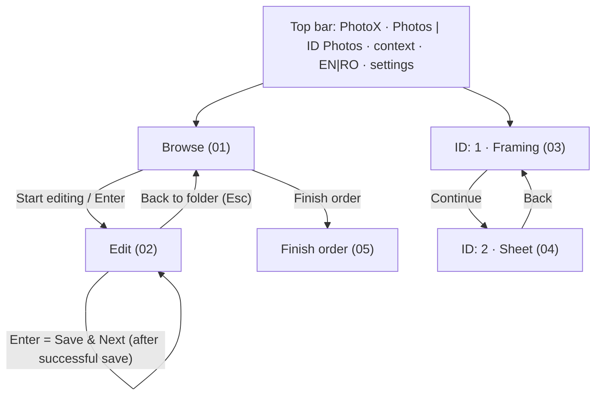

# PhotoX — UI Concept Mockups

> **Concepts, not screenshots** (plan revision P-2). They show intended layout and behaviour for feedback; the real interface is verified separately ([TEST_PLAN.md](../TEST_PLAN.md) TS-18). All photos are synthetic illustrations.
>
> **Superseded in detail since 0.5.0** by the owner's feedback ([prompt_03](../prompts/prompt_03.md)): a single fixed editor toolbar with Straighten, levels as one bar with three triangles, no RGB curves, saturation below tint, resizable panels, landscape 3×4 sheets without cut guides, no in-app title. [PLAN.md](../PLAN.md) describes the current behaviour.

Window: 1600×1000 with a Windows 11-style title bar. Requirement IDs refer to [../PLAN.md](../PLAN.md).

| # | Screen | English | Romanian | Shows |
|---|---|---|---|---|
| 01 | Main screen & explorer | [01-main-explorer-en.png](01-main-explorer-en.png) | [01-main-explorer-ro.png](01-main-explorer-ro.png) | Workspaces, EN/RO, drives and USB, recent orders, folder tree, gallery with status badges and filters *All / To do / Done* (*All* active, so edited photos are visible; *To do* would hide them), low-resolution warning, collapsible details panel, **Start editing**, **Finish order** (FR-001, 002, 008, 009, 039, 047, 072) |
| 02 | Photo editor | [02-photo-editor-en.png](02-photo-editor-en.png) | [02-photo-editor-ro.png](02-photo-editor-ro.png) | Default 10×15 crop on open; presets **10×15 / 15×20 / 13×18 / Custom**; orientation; **Crop to fill / Whole + borders**; reset crop and 90° rotation; histogram with levels; Auto Correct; exposure − / +; contrast; saturation; white balance; **tint**; straighten; filmstrip; **Save & Next (Enter)** saves this crop, then opens the next (FR-003, 004, 010–019, 043–045, 049, 073) |
| 03 | ID framing | [03-id-editor-en.png](03-id-editor-en.png) | [03-id-editor-ro.png](03-id-editor-ro.png) | Sizes **3×4, 3.5×4.5, 2×2 in (≈ 5.1×5.1 cm), 4×6 cm, 5×7 cm, 9×12, Custom**; fixed frame with oval and crown/eye/chin guides; Auto Align; zoom/rotate/move; exposure, contrast, white balance, **tint**; background brightness; experimental whitening (only if the evaluation shows it is useful) (FR-007, 061–065) |
| 04 | ID sheet | [04-id-sheet-en.png](04-id-sheet-en.png) | [04-id-sheet-ro.png](04-id-sheet-ro.png) | 3×4 cm sheet: 3×3 grid, **7 mm white strip under each photo** (cut 30×47 mm), 8 of 9 copies with quick counts, spacing, margins, cut guides; **output folder** (remembered) with *Change…*; timestamp filename `ID_20261029_1845.jpg`; JPEG/PNG; Save sheet (FR-066–FR-068, 074, 075) |
| 05 | Finish order | [05-finish-order-en.png](05-finish-order-en.png) | [05-finish-order-ro.png](05-finish-order-ro.png) | One confirmation: **Erase originals and edit history (default)** or Keep; unknown files untouched (FR-072) |

The app icon is [assets/logo/photox-icon.svg](../../assets/logo/photox-icon.svg) (PNG and ICO renders alongside it), FR-077.

Sources: [svg/](svg/), generated by [tools/build_mockups.py](tools/build_mockups.py) (documentation tooling, not app code):

```bash
python3 docs/mockups/tools/build_mockups.py   # writes svg/*.svg and renders *.png with headless Chromium
```

## Navigation



## Design notes

- **Neutral dark greys** around photos; green means done, amber attention or unsaved, blue the primary action.
- **Primary action bottom-right**, always in the same place: Start editing, Save & Next, Continue, Save sheet.
- **Save & Next is not a background operation.** The button shows progress while saving, and only then opens the next photo. A failure keeps the photo and its edits.
- **Finish order** is the only place where temporary originals are erased. Erase is the default and needs one confirmation.
- **Romanian:** decimal commas and comma-below ș/ț. Terminology to be reviewed by the owner (e.g. “Foto acte”, “Salvează și următoarea”, “Finalizare comandă”, “Nuanță”).

## Keyboard (FR-018)

| Context | Key | Action |
|---|---|---|
| Browse | Enter | open the selected photo, or the first one in *To do* |
| Edit | **Enter** | **Save & Next** (exact crop; wait for success) |
| Edit | Ctrl+S | Save (stay) |
| Edit | ← / → (PgUp / PgDn) | Previous / Next without saving |
| Edit | Ctrl+Z / Ctrl+Y | Undo / Redo |
| Edit | Space (hold) | Before / after |
| Edit | Esc | Back to folder |

Held-key auto-repeat is ignored. Shortcuts never act while text or number fields, lists or dialogs have focus.
