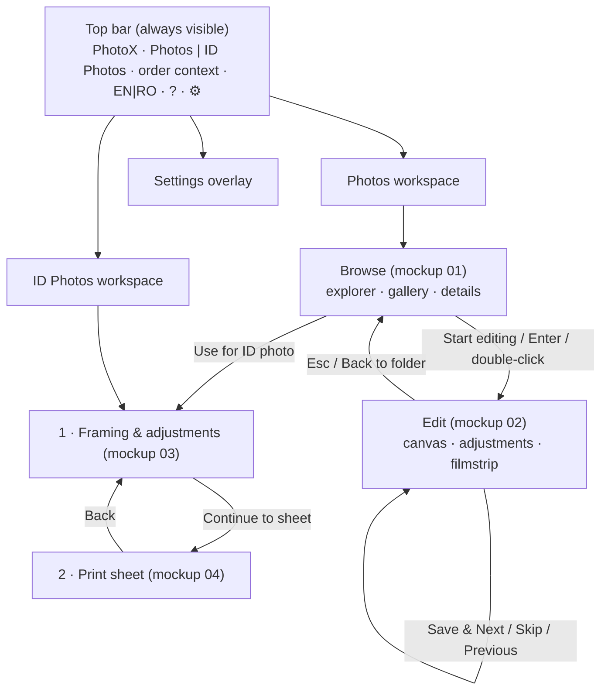

# PhotoX — UI Concept Mockups

> **These are concepts, not implemented interfaces.** They exist to collect feedback before implementation, and every image is labelled *CONCEPT* in its header strip. All photos are synthetic vector illustrations, with no customer data.

Requirements are referenced by ID from [../PLAN.md](../PLAN.md). Window size: 1600×1000 (16:10), shown inside a Windows 11-style title bar, because Windows 11 is the production platform.

## Index

| # | Screen | English | Romanian | Shows | Requirements |
|---|---|---|---|---|---|
| 01 | Main screen & file explorer | [01-main-explorer-en.png](01-main-explorer-en.png) | [01-main-explorer-ro.png](01-main-explorer-ro.png) | Workspace switch, EN/RO switch, locations (drives, USB), recent orders with progress, folder tree, thumbnail gallery with status badges and filters, low-resolution warning, details panel, order progress, **Start editing** | FR-001, FR-002, FR-053, FR-008, FR-009, FR-041, FR-047 |
| 02 | Ordinary photo editor | [02-photo-editor-en.png](02-photo-editor-en.png) | [02-photo-editor-ro.png](02-photo-editor-ro.png) | Default **10×15 crop** active on open, ratio and orientation chips, thirds grid, output px and ppi chip, histogram with levels, Auto Correct, exposure − / + with slider, contrast, saturation, white balance, rotate and straighten, undo/redo, filmstrip with status, background-save toast, Previous / Skip / Save / **Save & Next** with shortcuts, *Unsaved changes* pill | FR-003, FR-004, FR-052, FR-010–FR-019, FR-042–FR-045 |
| 03 | ID photo editor (framing) | [03-id-editor-en.png](03-id-editor-en.png) | [03-id-editor-ro.png](03-id-editor-ro.png) | ID format cards with px at 300 ppi, compliance disclaimer, fixed 35×45 frame with **oval, crown/eye/chin guides and tolerance bands**, head-height dimension, **Auto Align**, zoom/rotate/move, adjustments, **background brightness**, *Experimental* auto-whitening toggle with limitations note, two-step stepper | FR-007, FR-061–FR-065 |
| 04 | ID print-sheet preview | [04-id-sheet-en.png](04-id-sheet-en.png) | [04-id-sheet-ro.png](04-id-sheet-ro.png) | True-proportion 4×6 in page with six 3.5×4.5 photos and **cut guides**, page dimensions, per-photo mm and px callout, page selector, **layout cards computed by the layout engine** (6, 8 with tight-margin warning, 4, 2), copy count, spacing, margins, output summary, **Save layout** | FR-066–FR-068, FR-070 |

Editable sources are in [svg/](svg/) (one SVG per PNG). They are generated by [tools/build_mockups.py](tools/build_mockups.py), a documentation script and not application code:

```bash
python3 docs/mockups/tools/build_mockups.py   # writes svg/*.svg and renders *.png via headless Chromium
```

It uses Python 3 and, for PNG rendering, Chromium or Chrome; Pillow is optional (text measurement). To revise a mockup after feedback, edit the strings or layout in the script and re-run it, so all variants stay consistent.

## Navigation structure



- **Two levels at most.** Everything the operator needs during an order is on screen. There are no menus, no floating tool windows and no nested dialogs.
- **The top bar is stable:** the workspace switch and the language switch are always in the same place (owner requirement: the language is selectable from the main screen).
- **Settings** (media sizes, JPEG quality, templates, cache) is an overlay page reached from the gear icon. Nothing in the daily workflow requires it.

## Design rationale

| Choice | Why |
|---|---|
| **Neutral dark-grey theme**, hue-free greys around the photo | Coloured or bright UI around a photo biases colour and brightness judgement, which is why photo tools use neutral grey. Saturated colour is reserved for state (green = edited, amber = attention / unsaved, red = error) and one blue accent for primary actions. A light theme is possible later (FR-039). |
| **Large primary actions bottom-right** (Start editing, Save & Next, Continue, Save layout) | A consistent position builds muscle memory for repetitive work. Shortcut hints are printed on the buttons so operators learn them. |
| **Crop active immediately** with a chip showing format, output pixels and ppi | Removes one click per photo. The ppi chip makes print quality visible without a dialog (FR-047). |
| **Exposure − / + buttons** next to the slider | Owner requirement, and faster than precise dragging for the common “a bit brighter” case. |
| **Histogram on top of the adjustments panel** | Live feedback for every adjustment below it; the levels handles sit directly on it. |
| **Filmstrip with status badges** and a **save toast** | Progress and background-save results are visible without interrupting the flow. A skipped photo with pending edits shows an amber badge. |
| **Status badges in the gallery** (✓ edited, ! warning) and filters *All / To do / Edited* | Distinguishes processed and unprocessed photos (FR-002) and lets the operator jump to what is left. |
| **`Original` folder hidden**, shown only as a lock note in the sidebar | Owner requirement that backups are not part of the order, with transparency that they exist. |
| **ID: the frame is fixed, the photo moves** | Matches how operators think (“put the face in the oval”). Guides stay static and readable. |
| **ID: tolerance bands and a dimension bracket** | Turns template rules (head height 32–36 mm) into something visible, without claiming compliance. |
| **Experimental badge and limitation text** on auto-whitening | The owner requires that unreliable automation be clearly marked. |
| **Layout cards computed from geometry**, with warnings | The sheet engine offers what fits (FR-066) rather than fixed counts. “Tight margins” warns before printing problems. |
| **Romanian with decimal commas** (3,5 × 4,5 cm) and comma-below ș/ț | Correct localization, not only translation. The RO variants also test that longer strings fit. |

## Keyboard shortcuts

Proposed set (FR-018, OQ-014). Shortcuts are shown on buttons and in a “?” overlay.

| Context | Key | Action |
|---|---|---|
| Browse | Enter | Start editing (first unedited, or selected) |
| Browse | Arrow keys, Ctrl/Shift+click | Move / extend selection |
| Edit | **Enter** | **Save & Next.** Ignores key auto-repeat, ignored for 300 ms after a photo opens, inactive in text fields. |
| Edit | Ctrl+S | Save (stay) |
| Edit | → / ← | Skip (next, no save) / Previous. Pending edits are kept. |
| Edit | Ctrl+Z / Ctrl+Y (Ctrl+Shift+Z) | Undo / Redo |
| Edit | Space (hold) | Before / After |
| Edit | R / Shift+R | Rotate 90° right / left |
| Edit | O | Toggle crop orientation (portrait/landscape) |
| Edit | 1 / 2 / 3 | Crop preset 10×15 / 15×20 / Custom |
| Edit | + / − | Exposure ± one step |
| Edit | A | Auto Correct |
| Edit | Esc | Back to folder |
| ID framing | A | Auto Align |
| ID framing | Arrow keys / Shift+arrows | Move photo 0.1 mm / 1 mm |
| ID framing | Scroll / Shift+scroll | Zoom / rotate |
| Global | F1 | Help / shortcut overlay |

## Questions for the reviewer

1. Is a dark theme right for the studio environment (lighting, monitor), or is a light explorer screen preferred?
2. Should the right-hand details panel in Browse stay, or should the gallery use the full width?
3. Is the filmstrip in the editor useful, or would a larger photo area be better?
4. Are the Romanian labels natural? In particular “Foto acte”, “Salvează și următoarea” and “Coală de imprimare”. See OQ-022.
5. Are any of the proposed shortcuts likely to conflict with the operator's habits from ACDSee or the Mitsubishi software?
6. Is the step indicator (1 → 2) in the ID workspace clear enough, or should the sheet be on the same screen?
